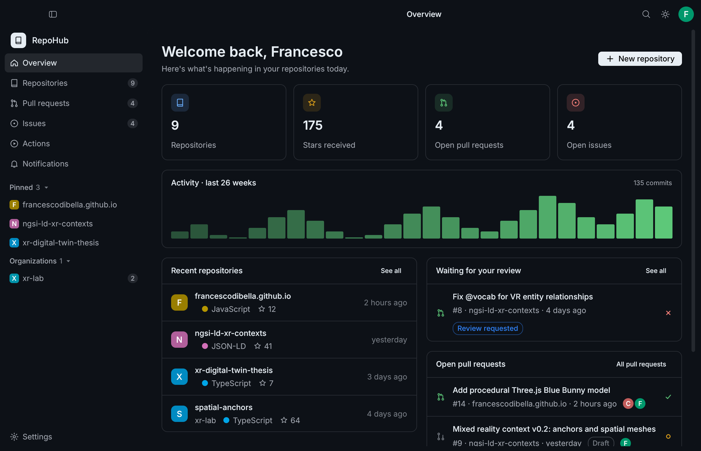
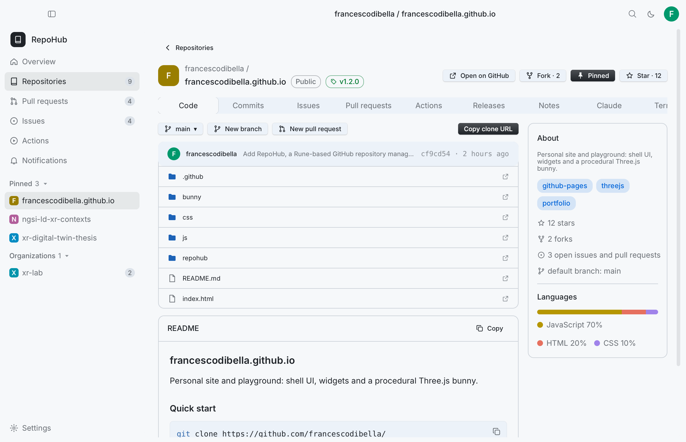
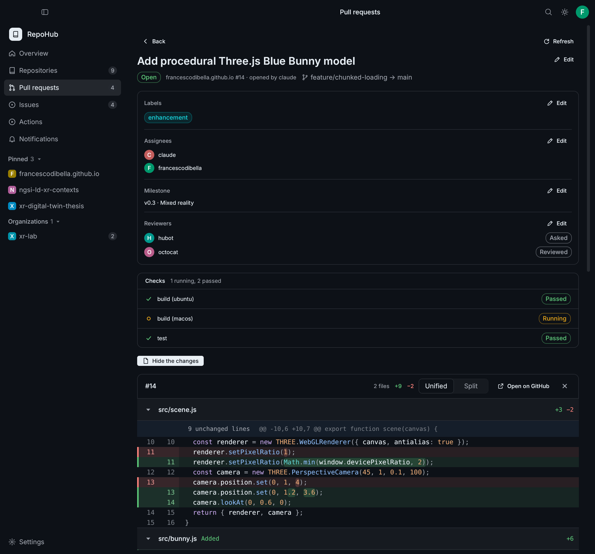
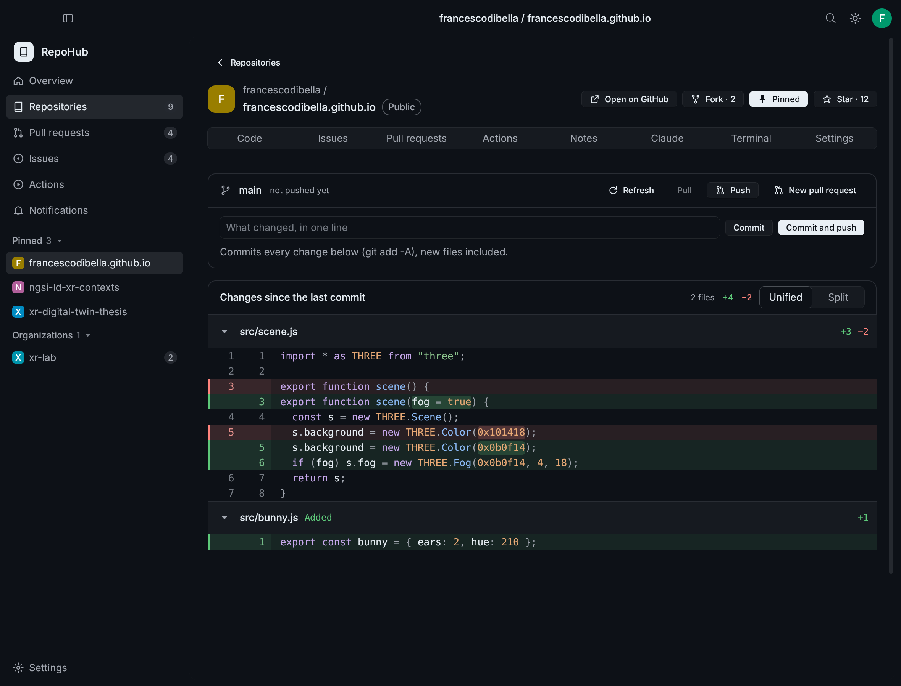
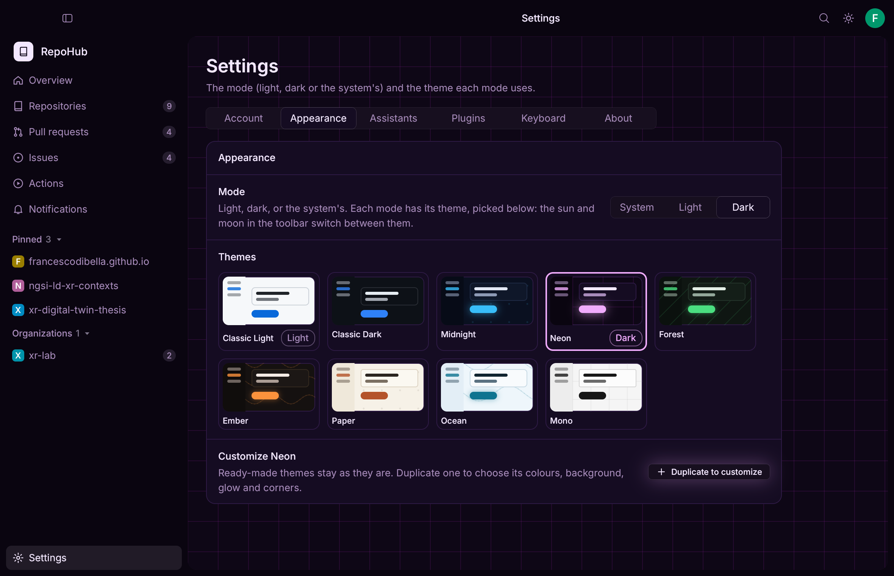
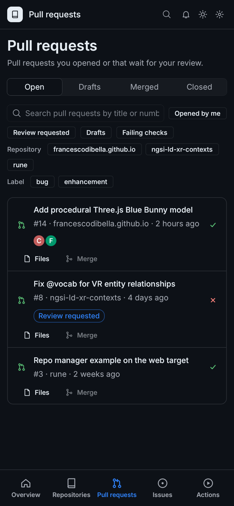
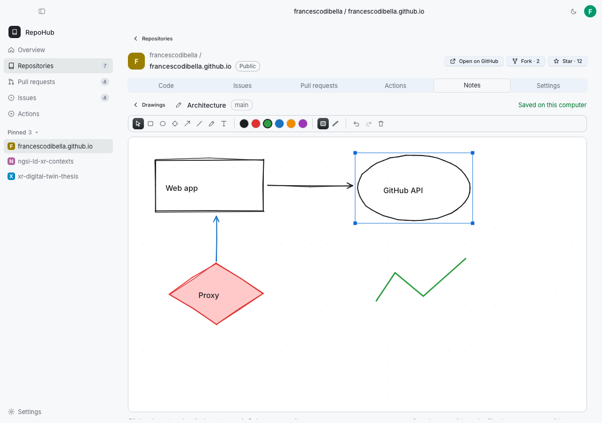
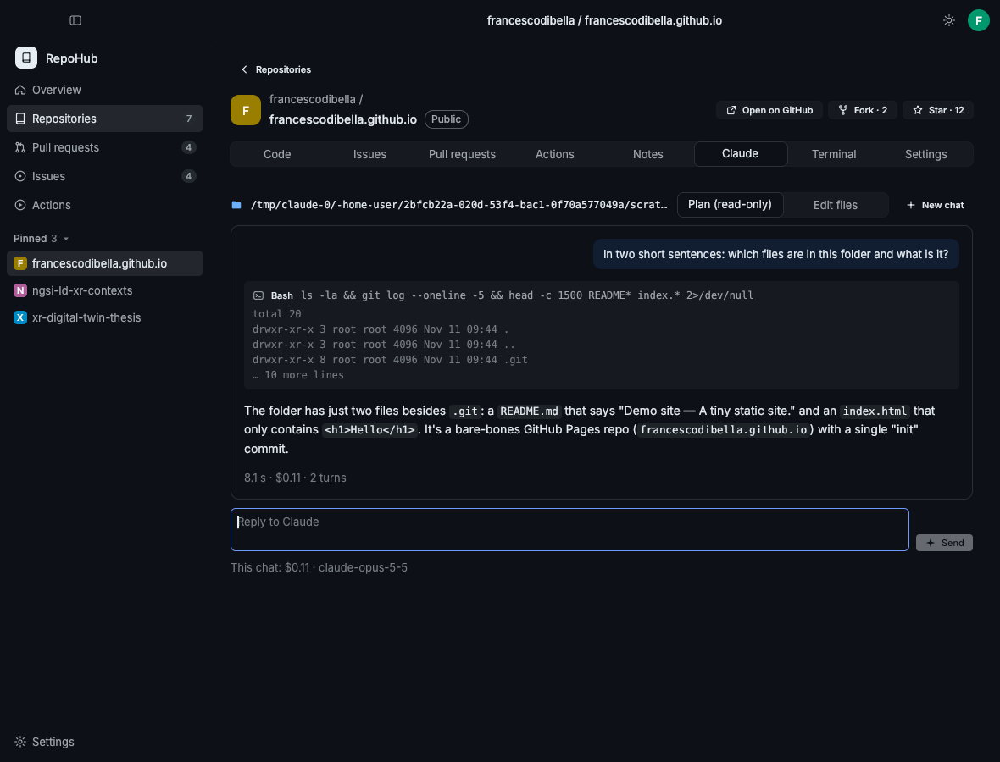
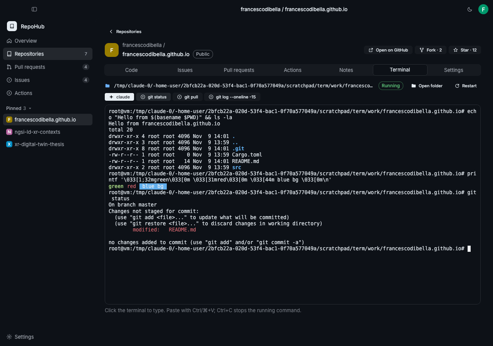

# RepoHub

A dashboard for your own GitHub repositories, written in Rust with
[Rune](https://github.com/anomalyco/rune) (a GPU-rendered UI framework) and `rune-kit`.

It reads real data from the GitHub REST API: profile, repositories, files, README, languages,
commits, pull requests, issues, notifications, workflow runs and weekly commits. From the
app you can also:
- **read and answer** issues and pull requests: comment, review, comment on diff lines, see the
  checks, merge, close and reopen;
- **filter** issues and pull requests, and go through your **notifications**;
- read a branch's **commits**, open one to see what it changed, and **compare** two branches
  before opening a pull request;
- read a repository's **releases** and tags, draft a release with GitHub's generated notes and
  publish it;
- work in a repository's **local clone** (desktop): its files, its changes as a diff, commit,
  push and pull, a **Terminal** and **Claude**;
- keep **notes**: hand-drawn diagrams and sketches for each repository and branch, on every
  device through a private repository of yours, and exported as `.excalidraw` files;
- pick or make a **theme**, and add **plugins**.

| | |
| --- | --- |
|  |  |
|  |  |
|  |  |

The pictures are made from the sample data by `scripts/screenshots.sh`.

**Contents:** [Docker](#run-it-with-docker) · [Desktop app](#desktop-app) ·
[Android app](#android-app) · [Themes](#themes) · [Working on GitHub](#working-on-github-from-the-app) · [Commits](#commits) · [Releases](#releases) ·
[Files on your computer](#files-on-your-computer-desktop-app) · [Notes](#notes) ·
[Status bar](#status-bar-desktop-app) · [Claude](#claude-desktop-app) · [Plugins](#plugins-desktop-app) ·
[Terminal](#terminal-desktop-app) · [Configuration](#configuration) · [What it shows](#what-it-shows) ·
[Development](#development)

There are four ways to run it:

| | What you need | Data |
| --- | --- | --- |
| **Docker** (recommended) | Docker and a browser with WebGPU | yours, from `.env` |
| **Desktop app** | Rust | yours, from `.env` |
| **Android app** | Android 12 or later | yours, from Settings on the phone |
| **Static page** (GitHub Pages) | a browser with WebGPU | sample data only |

## Run it with Docker

All you need is [Docker](https://docs.docker.com/get-docker/) (Docker Desktop on Windows and
macOS).

```sh
git clone https://github.com/FrancescoDiBella/repohub
cd repohub
cp .env.example .env        # on Windows: copy .env.example .env — set REPOHUB_SECRET and GITHUB_USER/GITHUB_TOKEN
docker compose up --build   # the first build compiles everything: 10–20 minutes
```

Then open **http://localhost:8080** in Chrome or Edge, which support WebGPU, and enter your `REPOHUB_SECRET` to unlock the app. Some useful commands:
- `Ctrl+C` stops it.
- `docker compose up -d` runs it in the background.
- `docker compose down` removes it.
- After editing `.env`, `docker compose up -d --force-recreate` applies the change without rebuilding.

### How the token stays safe

The image contains two things:
- the web build of RepoHub, compiled to WebAssembly;
- `repohub-server`, a small server that serves the page and forwards API calls to GitHub,
  adding the token on the way.

What this means for the token:
- The token never leaves the container. The page never receives it: `config.json` only says
  whether a token is set.
- The port is published on this computer only (`127.0.0.1:8080`).
- The server forwards only the exact endpoints RepoHub uses (`allowed()` in `server/src/main.rs`):
  reads, starring, creating issues, branches and pull requests, comments and reviews, closing and
  reopening issues and pull requests, merging pull requests, and marking notifications as read.
  Nothing that deletes or rewrites repositories.
- When `REPOHUB_ALLOW_WRITES` is off (the default whenever binding to a non-loopback address),
  all write methods (`POST`, `PUT`, `PATCH`, `DELETE`) are rejected with `403 Forbidden`.
- The server compares the full `Origin` (scheme, host and port) against `Host`, requires `X-RepoHub: 1`
  and `Content-Type: application/json` on writes to trigger browser CORS preflights, and refuses
  requests with an unknown `Host` header to block DNS rebinding.
- When bound to a non-loopback address (e.g. `0.0.0.0:8080` in Docker), `REPOHUB_SECRET` is required;
  the server unlocks via an `HttpOnly` cookie or an `Authorization: Bearer <secret>` header.

To reach RepoHub from another device on your network, set `REPOHUB_SECRET` in `.env`, change `ports`
in `compose.yaml` (or run with `-p 8080:8080`), and add the host name to `REPOHUB_ALLOWED_HOSTS`.
Optionally enable writes with `REPOHUB_ALLOW_WRITES=true`. Do this only on a network you trust:
anyone with the secret uses your token.

### On your phone

Below 720 points of width RepoHub switches to a phone layout: a top bar, the page in one column
and a tab bar at the bottom (Overview, Repos, Pulls, Issues, Actions) instead of the sidebar. The
same happens in a narrow desktop window. Notes work with touch; the terminal stays desktop-only.

### Android app

RepoHub is also an Android app that needs no server. Download
`RepoHub-<version>-android.apk` from the
[Latest build](https://github.com/FrancescoDiBella/repohub/releases/tag/latest), open it on the
phone and allow the installation.

- **Account:** open Settings (the gear), type your user name and a token, and press **Connect**.
  The token stays on the phone, encrypted with a key that can't leave it, and is only ever sent
  to GitHub.
- **What it has:** the overview, repositories, pull requests, issues, workflow runs, README and
  code; creating issues, branches and pull requests, and merging; Notes.
- **Notes:** a drawing opens full screen. One finger draws with the chosen tool, **Move the
  view** drags the drawing, and plus and minus zoom. Drawings are kept on the phone and, with a
  notes repository chosen in Settings, [sync](#boards-on-every-device) with your other devices.
  **Export** opens the phone's "save to" picker; **Import…** its file picker.
- **Back:** the back button closes what's open, then goes up a page, then leaves the app.
- **Not on the phone:** the terminal, Claude, local clones and plugins need a computer.
- **Needs:** Android 12 or later with a current Android System WebView (121 or later).
- **Updates:** unless the build is signed with your own key, remove the app before installing a
  newer APK. [`android/README.md`](android/README.md) explains signing and how to build it.


The phone opens the same web app the Docker container serves. Two things to know:

- **Browsers only offer WebGPU on HTTPS pages** (or `localhost`), so `http://192.168.x.x:8080`
  doesn't work from the phone. Put the container behind HTTPS, on a private network. The simplest
  way is [Tailscale Serve](https://tailscale.com/kb/1312/serve): with Tailscale on the computer and
  the phone, `tailscale serve 8080` gives a `https://<computer>.<tailnet>.ts.net` address only
  your devices can open. Add that host name to `REPOHUB_ALLOWED_HOSTS` in `.env`.
- **Browser support:** Chrome on Android 12 or later, and Safari on iOS 26 or later.

Then use the browser's **Add to Home Screen**: RepoHub opens full screen with its own icon.
The server holds your token, so never publish the port on the open internet.

### Prebuilt image

The `image` workflow publishes `ghcr.io/francescodibella/repohub` on every push to `main`, for
Intel/AMD (`linux/amd64`) and ARM (`linux/arm64`, Apple silicon included). Once it's published,
there is nothing to build:

```sh
docker run --rm --env-file .env -p 127.0.0.1:8080:8080 -v repohub-notes:/data ghcr.io/francescodibella/repohub
```

A new GHCR package starts out private. Either make it public (your GitHub profile → Packages →
repohub → Package settings) or run `docker login ghcr.io` first.

## Desktop app

A native app for macOS, Windows and Linux: its own window, no browser and no Docker. It is the
only version with the [terminal](#terminal-desktop-app).

### Install

Download the build for your system from the
[Releases](https://github.com/FrancescoDiBella/repohub/releases) page:

- **macOS** (Apple silicon and Intel): open `RepoHub-<version>-macos.dmg` and drag RepoHub to
  Applications. The app isn't notarized by Apple, so the first time right-click it and choose
  **Open**, or run `xattr -dr com.apple.quarantine /Applications/RepoHub.app`.
- **Windows**: unzip `RepoHub-<version>-windows.zip` and run `RepoHub.exe`. SmartScreen may ask
  for confirmation (*More info* → *Run anyway*).
- **Linux** (x86-64): unpack `RepoHub-<version>-linux-x86_64.tar.gz` and run `./install.sh`, which
  puts the program in `~/.local/bin` and adds a launcher entry.

Every push to `main` rebuilds the three packages and replaces the
[**Latest build**](https://github.com/FrancescoDiBella/repohub/releases/tag/latest) pre-release,
so the newest app is always there without doing anything. Pushing a tag such as `v0.1.0`
publishes a numbered release next to it.

### Updates

The app updates itself from one of two channels, picked in **Settings → About → Channel**:
- **Stable**: the [numbered releases](https://github.com/FrancescoDiBella/repohub/releases)
  (`v0.1.0`, …). A numbered build starts here.
- **Preview**: the [Latest build](https://github.com/FrancescoDiBella/repohub/releases/tag/latest),
  rebuilt on every change to `main`. A Latest build starts here.

The version (`0.1.0`, or `0.1.0-dev` for a Latest build) shows in Settings → About and in the
status-bar menu.

- It checks GitHub at start and every 6 hours (**Settings → App version → Check now**, or ⌘K →
  *Check for updates*, any time).
- When a newer build is out, a banner (and the status-bar menu) offers **Install and restart**.
  The package for your system is downloaded, checked against the release's `SHA256SUMS`, put in
  place of the running app, and the new version starts.
- Updates are downloaded only from GitHub's release hosts. When the repository has a signing
  key, the checksums are signed and the app refuses an update whose signature is missing or
  isn't RepoHub's, so replacing a release's files isn't enough to ship code to you. On macOS the
  new app's code signature is checked before it replaces the old one.
- macOS replaces `RepoHub.app` where it is (it needs to be in a folder you can write to, such as
  Applications); Windows replaces `RepoHub.exe`; Linux replaces the `repohub` program.
- `REPOHUB_UPDATES=off` turns the checks off. Builds from source update with `git pull`, the
  Docker version with `docker compose pull`.

### Release notes

What changed in each version is in [`CHANGELOG.md`](CHANGELOG.md). The section of a tagged
version (`v0.2.0`) becomes that release's notes. The Unreleased section becomes the notes of the
Latest build, and the update banner shows them under **What's new** before you install.

### Connect your account

Open **Settings → GitHub account**, type your user name and (optionally) a token, and press
**Connect**. No `.env` file is needed.

- With only a user name RepoHub shows your public repositories.
- A token adds private repositories and starring. The **Create a token** button opens the right
  GitHub page.
- The account is saved in the app's settings file, which only you can read:
  `~/Library/Application Support/RepoHub/.env` (macOS), `%APPDATA%\RepoHub\.env` (Windows) or
  `~/.local/share/repohub/.env` (Linux). Any setting from [`.env.example`](.env.example) works
  in that file too.
- A `GITHUB_USER` or `GITHUB_TOKEN` from the environment or a project `.env` wins over the saved
  account; Settings says so when that happens.

### Build from source

You need [Rust](https://rustup.rs). The toolchain version is pinned in `rust-toolchain.toml` and
installed automatically.
- Linux: you also need `libxkbcommon-dev` and `libwayland-dev`.
- Windows: you also need the Visual Studio C++ Build Tools.

```sh
cp .env.example .env                  # optional: set GITHUB_USER and/or GITHUB_TOKEN, or connect in Settings
cargo run --release                   # the first build takes a few minutes
packaging/macos/bundle.sh 0.1.0       # macOS: builds dist/RepoHub.app and the .dmg
```

## Themes

**Settings → Appearance** has ready-made themes: Classic Light and Dark, Midnight, Neon, Forest,
Ember, Paper, Ocean and Mono. Pick one for the light appearance and one for the dark one. The
Mode (System, Light or Dark) and the toolbar's sun and moon switch between them. ⌘K → *Theme: …*
works too.

To make your own, choose **Duplicate to customize**. Then you can change:
- **Colours** for each part of the window: page, sidebar and toolbar, panels and cards, text,
  secondary text, accent, borders, background pattern, and the success, warning and danger
  states (`#rrggbb`).
- **Background:** plain, a pattern (dots, grid, lines, diagonal, waves) with its strength and
  size, or a picture (a file on your computer or an `https://` address).
- **Effects:** a glow on buttons, the roundness of corners, and main buttons in the accent colour.

Changes show at once and are saved with your preferences.

## Pinned repositories

The sidebar's **Pinned** section (also in the status-bar menu) starts with `REPOHUB_PINNED` or,
without it, the three most recently pushed repositories. Pin or unpin any repository with the pin
on its card, **Pin** on its page or ⌘K → *Pin …*. The first change starts from what the sidebar
shows, and your pins are remembered from then on (they win over `REPOHUB_PINNED`).

## Where you left off

RepoHub reopens where you were: the page, the repository and its section (Code, Claude,
Terminal…), the sidebar's width and whether it was open, and the Repositories page's sort and
owner filter. It waits for the repositories to load before opening a repository; if that
repository is gone it shows the Repositories page, and if you move first, your move wins. A page
on the command line (`-- page …`, used by scripts) wins too.

The filters of the Pull requests and Issues pages are kept too: between visits, and between
runs (with the place, in the preferences). **Clear** resets them. The sample data keeps none.

## Organizations

The repositories of the organizations you belong to show next to yours, ordered by last push.
Everything works on them as on your own: Code, branches, issues, pull requests, Notes, Claude,
Terminal.

- The Repositories page filters by owner (**All**, **Mine**, each organization); the sidebar's
  **Organizations** section and the command palette (`Repositories in …`) open the same filter.
- Their open issues join the Issues page; pull requests already include everything you're
  involved in.
- `REPOHUB_ORGS` chooses which: empty for all, `none` for only yours, or a list (`acme,xr-lab`).

What you see depends on the token:

| Token | Organization repositories shown |
| --- | --- |
| none | public ones, of the organizations whose membership is public |
| classic, `repo` + `read:org` | all you can access, private included |
| fine-grained | only those of its resource owner: create one whose owner is the organization (the organization must allow fine-grained tokens) |

Organizations that use SAML single sign-on also need the token authorized for them (on GitHub:
Settings → Developer settings → the token → Configure SSO).

## Staying up to date

While an account is connected RepoHub refreshes by itself every 10 minutes
(`REPOHUB_REFRESH_MINUTES`; `0` turns it off), also while it waits in the status bar. Without a
token it never refreshes more often than every 30 minutes, so it can't use up GitHub's 60
requests an hour. A refresh that fails is tried again after the next interval.

"Updated 3 minutes ago" shows on the Overview, in the refresh button's tooltip, in the status-bar
menu and in Settings, which also says when the next refresh is due. ⌘R (Ctrl+R) refreshes now.

**Opening at once.** After each load RepoHub saves a copy of the lists (and of the repository
pages you opened), and the next start shows it in the first frame with "Updating…" until GitHub
answers. If GitHub can't be reached, the copy stays and the banner says how old it is.
- Desktop: `<data dir>/cache/<host>-<account>.json` (`~/.local/share/repohub` on Linux,
  `~/Library/Application Support/RepoHub` on macOS, `%APPDATA%\RepoHub` on Windows), readable by
  you only. Web and Android: the browser's storage, when it fits (the largest parts are left out
  first).
- Never your token. Removed when you sign out or switch accounts, and with **Settings → About →
  Clear saved data**, which also says where it is, how large and from when. At most 12 MB.
- `REPOHUB_CACHE=off` turns it off (desktop).

**Lighter refreshes.** RepoHub keeps each answer's tag (`ETag`) and asks "changed since?"
(`If-None-Match`). When nothing changed GitHub answers `304 Not Modified`, which doesn't count
against the rate limit, so a refresh with nothing new costs almost nothing: only the four
searches (pull requests, review requests, issues) are read again, as GitHub's search has no tags.
The tags are saved with the copy, so the first refresh after a start is light too.
`repohub-server` and the Android app pass both headers on.

**Loading in parallel.** The parts of a load that don't need each other run side by side, at most
four requests at a time: repositories next to pull requests, then issues, runs and activity. On
a first start the profile and the repositories show as soon as they're in, and pull requests,
issues and runs fill in when they arrive. Repository pages, branch lists, labels and
conversations already read in this session show at once when opened again, and are read again
behind them.

Measured against a mock GitHub that answers every request after 150 ms (200 repositories;
`scripts/bench-load.sh`, times from the start of the app):

| | before: first content | before: complete | now: first content | now: complete | requests answered 200 / 304 (before → now) | sent by GitHub |
| --- | --- | --- | --- | --- | --- | --- |
| first start | 3.5 s | 3.5 s | 0.64 s | 1.27 s | 18 / 0 → 18 / 0 | 1.3 MB → 1.3 MB |
| next start | 3.4 s | 3.4 s | 0.01 s (the saved copy) | 1.13 s | 18 / 0 → 4 / 14 | 1.3 MB → 0.2 MB |
| refresh, nothing changed | — | 3.3 s | — | 1.10 s | 18 / 0 → 4 / 14 | 1.3 MB → 0.2 MB |

## Search and commands

**⌘K** (Ctrl+K on Windows and Linux), or the search button in the toolbar, opens a palette over the
window. Type a few letters (they can be the start of any word, or just letters in order: `rhb`
finds `repohub`) and press Enter:

- any page, repository, open pull request or issue;
- for the repository on screen: New issue, New pull request, New branch, New release, Ask
  Claude, Open a terminal, Open on GitHub, Copy the clone URL, Commits of it, Releases of it, and
  its other sections;
- Refresh and the theme.

↑ ↓ move through the results, Esc or a click outside closes it.

## Working on GitHub from the app

With a token that has write access, the everyday changes happen in RepoHub:

| Where | What |
| --- | --- |
| Code tab | **Branch picker** (the branch button): files, last commit and README follow the branch you pick, and so does the Notes tab. **New branch** starts one from the branch on screen. |
| Code or Pull requests tab | **New pull request**: pick its branch and the one it goes into, title, description, draft. |
| Issues tab | **New issue**: title, Markdown description, and optional **Labels** and **Assignees** (the same pickers as in a conversation), sent with the issue. |
| Issue and pull request rows | Click one to **read its conversation**: the description, comments and reviews, as formatted text. Write a **comment** there. On a pull request, its **checks**, **Approve**, **Request changes**, **Close** or **Reopen** and **See the changes** (the diff), with the comments left on its lines; the **+** by a line number comments on that line. On an issue, **Close issue** or **Reopen issue**. **Open on GitHub** is still there. |
| A conversation's details | Beside the conversation on a wide window, above it on a phone: **Labels**, **Assignees**, **Milestone** and, on a pull request, **Reviewers** (who is asked, and who reviewed with their verdict). **Edit** opens a picker in place: a filter and the repository's choices as a checklist (labels with their colour, people with their avatar; one milestone, or **No milestone**). **Apply** sends one change, **Cancel** drops it. The choices load when a picker first opens and are kept for the repository. |
| A conversation's title and description | **Edit** (when it's yours, or in one of your or your organizations' repositories): the title in a field, the description in the Markdown editor, **Save** or **Cancel**. What you typed stays if saving fails. |
| Issue rows | **Close**. |
| Notifications page | Your unread GitHub notifications, grouped by repository, with why you got each. Click one to open its conversation; it's marked as read. **Mark as read** does only that. Needs a classic token with the `notifications` or `repo` scope: GitHub doesn't give notifications to fine-grained tokens. |
| Pull requests and Issues pages | **Filters**: search by title or number, pick a repository or a label, **Opened by me**, **Review requested**, **Drafts** and **Failing checks** (pull requests) or **Assigned to me** (issues). They narrow what's already loaded, as you type, and are kept between visits and runs. Rows show up to three assignees' avatars, and pull requests that wait for your review say so. |
| Overview | **Waiting for your review**: the open pull requests where your review is requested, above the open pull requests, when there are any. |
| Pull request rows | **Files** shows what it changes as a diff, unified or side by side, with syntax colours and word changes. From there **Merge** with a merge commit, **Squash** or **Rebase**. **Merge** on the row asks first. |
| Changes tab (desktop, with a local clone) | What changed since the last commit, as a diff, new files included. **Commit** or **Commit and push** everything with a message. **Push**, **Pull** (fast-forward only), and **New pull request** from the branch. |
| Notes tab | With a notes repository chosen (Settings → Account → Boards), each change to a board is one commit to `boards/…/<name>.excalidraw` there, and a board deleted here is deleted there. See [Boards on every device](#boards-on-every-device). |
| Releases tab | **New release**: a tag (the next versions are offered), the branch a new tag is made from, title, Markdown notes with **Generate notes**, pre-release. **Save draft**, or **Publish release** after a question. On a draft: **Edit** and **Publish** (it asks first). |
| Changes tab: merging | **Merge a branch** into the one checked out: pick it to preview its commits and the diff it brings, then merge. If there are conflicts, it lists the files and offers **Abort merge**. Fix them in your editor or the Terminal, then **Commit** finishes the merge. Commit refuses files that still have conflict markers. |

What GitHub creates shows at once; the lists catch up on the next refresh. GitHub's error, if
any, shows in the form (for example "A pull request already exists"). A label, assignee,
milestone, reviewer, title or description change updates the conversation and the list rows
without a reload, with a message; when GitHub refuses (the token may only read the
repository), the details say so once and keep the old values.

RepoHub still doesn't delete repositories, branches, releases or tags, upload files to a release,
or rewrite history: those stay on GitHub.
Commit, push and pull run the `git` installed on your computer, in the clone, with your own
credentials.
In Docker the same actions go through `repohub-server`, which forwards only these writes.

The token needs, as a fine-grained token: **Contents**, **Issues** and **Pull requests** read
and write, **Metadata** and **Actions** read. A classic token needs the `repo` scope.

## Commits

A repository's **Commits** section (after Code) shows the history of the branch picked in the
branch picker, newest first and grouped by day (Today, Yesterday, 12 November…). Each row has the
first line of the message, who wrote it (their GitHub account, or the name in git when GitHub
knows no account for them), the short commit id, how long ago, and **Verified** when GitHub
checked its signature. **Copy id** copies the full id, the arrow opens it on GitHub.

- **Load more** reads the next 30; the end of the list says whether GitHub has more.
- The **filter** narrows the commits already loaded by message, author or commit id, as you type.
- On the desktop, when the Changes tab has seen that your local clone has commits to push or
  to pull, a line above the list says so, with a link to the Changes tab.

**Click a commit** to open it in place of the list: its whole message, who wrote it and who
committed it, when, its parent commits (click one to open it; Back comes back), and what it
changed as a diff, unified or side by side (always unified on a phone). It says when GitHub
shows no diff for a file (binary or too large) and when a commit has more than the 300 files
GitHub lists. **Back**, Esc or ⌘[ (Ctrl+[) returns to the list where you were.

**Compare** opens a small form: the branch to compare (the one on screen) and the branch it's
compared with (the default branch). The result says how far apart they are ("3 commits ahead,
1 behind main"), lists the commits and shows what they change together. When the branch is
ahead and no pull request is open for it, **New pull request** opens the form with both branches
filled in; when one is open, a button opens it. Identical branches, a branch with nothing new and
branches with no history in common get a sentence instead.

## Releases

A repository's **Releases** section (after Actions) lists its releases, newest first, 20 at a time
with **Load more**. Each shows its title, its tag, a word for its state (**Latest**,
**Pre-release** or **Draft**), who published it and when, and its notes as formatted text; notes
longer than a dozen lines end with **Show all**. Its files are listed with their size and how
many times they were downloaded: click one to download it in the browser (GitHub's source
archives aren't listed). The arrow opens the release on GitHub. Drafts show only to people who
can push to the repository: GitHub decides. Under the list, **Tags without a release** lists the
tags no release uses, each with **Draft a release**.

The repository's header shows the latest release's tag next to Public or Private; clicking it
opens the section.

**New release** opens a form:
- **Tag**: type one, or pick one of the next versions offered after the newest tag that looks
  like a version (`v1.2.3` offers `v1.2.4`, `v1.3.0` and `v2.0.0`; a repository with none offers
  `v0.1.0`). It says whether the release uses an existing tag or creates it, and from which
  branch (the branch picker; the default branch at first). A tag follows the rules of a branch
  name, and one that another release uses is refused before anything is sent.
- **Title** (the tag when left empty) and **Notes** in Markdown. **Generate notes** asks GitHub
  for the notes since the previous release; if you typed notes, it asks before replacing them.
- **Pre-release**, then **Save draft** or **Publish release**. Publishing creates the tag,
  notifies the repository's watchers and can start workflows, so it asks first ("Publish v0.2.0
  from main? This creates the tag and can't be undone from RepoHub."). Saving a draft doesn't.

A draft has **Edit** (the same form, filled in) and **Publish** (it asks first). RepoHub doesn't
upload files: **Add files on GitHub** opens the draft there. After a save the list and the header
show it at once. When GitHub refuses (for example a tag that already has a release, or a token
without the Contents permission), the form keeps what you typed and says why.

## Files on your computer (desktop app)

When RepoHub knows a repository's local clone (found as in the Terminal tab, or a folder you
picked), the Code tab reads its files from the disk instead of GitHub. That's instant, works
offline, uses none of GitHub's requests, and includes what you haven't committed yet.

- Folders open in place. A trail of folder names takes you back up.
- Changed files are marked: M modified, A added, D deleted, R renamed, U new (not tracked yet),
  ! in conflict. The title counts them.
- A file opens with syntax colours, and Markdown is rendered. Copy takes the whole file, and
  GitHub opens the committed version. Files longer than 5,000 lines or 1 MB show their beginning,
  and binary files show a note.
- Files git ignores are left out. **Refresh** lists the files again after you change them
  outside RepoHub, and **GitHub** switches to the files on GitHub.

## README

The Code tab shows the repository's README rendered as Markdown. Select text as on a web page
(drag, double- or triple-click; Ctrl/⌘+A for all) and copy it with Ctrl/⌘+C or a right-click.
Copying whole blocks copies their Markdown, so a pasted code block keeps its fences. **Copy** in
the panel's head copies the whole README, and each code block has its own copy button.

## Notes

Each repository has a **Notes** tab with a small whiteboard in the spirit of
[Excalidraw](https://excalidraw.com), built natively with Rune.



- **Branches:** pick a branch, then name a drawing to create it or open an existing one. Each
  branch keeps its own drawings.
- **Shapes:** rectangles, ellipses, diamonds, arrows, lines, freehand strokes and text, with the
  hand-drawn look Excalidraw is known for.
- **Style:** six colours, filled shapes and bold strokes.
- **Editing:** select and drag to move, Delete to remove, Ctrl/⌘+Z to undo and Ctrl/⌘+Shift+Z to
  redo.
- **Saving:** every change is saved at once, in Excalidraw's `.excalidraw` format, so a drawing
  also opens on excalidraw.com (*Open* → pick the file). Elements RepoHub doesn't draw (images,
  frames) stay in the file when you draw on it.
- **Export… and Import…:** **Export…** (on a drawing's row or in the editor) saves
  `<name>.excalidraw` where you choose: the system's save dialog on the desktop (the Downloads
  folder where there's none), a download in the browser, the "save to" picker on Android.
  **Import…** (next to Refresh) adds an `.excalidraw` file as a new drawing; a name that exists
  gets a number, and the toast says how many elements RepoHub couldn't draw and skipped. Neither
  needs an account.

Drawings are stored at `notes/<owner>/<repo>/<branch>/<name>.excalidraw` inside:
- the desktop app: `REPOHUB_DATA_DIR`, or the platform's data folder (`~/.local/share/repohub`,
  `~/Library/Application Support/RepoHub`, `%APPDATA%\RepoHub`);
- Docker: the `notes` volume (`/data` in the container), which survives rebuilds and updates;
- the Android app: the app's private storage on the phone.

The static GitHub Pages build has nowhere to store them, so the tab explains that instead.
A deleted drawing goes to `trash/<date>/…` next to `notes/` and stays there 30 days, so a wrong
delete can be undone by moving the file back.

### Boards on every device

Boards sync through **one private repository on your GitHub account**, the *notes repository*:
draw on the phone, open the computer, and the board is there.

1. Create a private repository on GitHub, for example `repohub-notes` (**Create it on GitHub** in
   Settings opens the page; RepoHub doesn't create repositories).
2. In **Settings → Account → Boards**, type it as `owner/name` and press **Use it**. RepoHub checks
   that it exists and that you can write to it, and asks first if it's public ("Everyone could
   see your boards"). The choice is saved per account; empty means sync is off.
3. Do the same on your other devices.

The token needs **Contents: read and write** on that repository (a fine-grained token can be
limited to it). Boards go to `boards/<owner>/<repo>/<branch>/<name>.excalidraw` on its default
branch, encoded as the local folder is, one commit per change (`Update Plan (octo/app@main)`,
`Delete …`).

- **When:** when the Notes tab opens, a few seconds after a board is saved (never in the middle
  of a stroke), on **Sync now**, and with the app's refresh. Drawing never waits for it.
- **Changes on both devices** are merged: the strokes of both stay, and for a shape moved on both,
  the later edit wins. If two copies can't be merged at all, both are kept: the other device's
  is saved as `<name> (conflict <date>)` and a toast says so.
- **Deleting** a board deletes it on the other devices too, unless one of them changed it since:
  then it comes back. What sync deletes here goes to the trash too.
- **A board open in the editor** shows what arrives at once if you haven't drawn since the last
  save; otherwise the next save merges it.
- **Offline or rate-limited:** boards keep working here; the Notes header says how many wait to
  be sent, with **Retry**.
- The Notes header says **Synced 2 minutes ago**, **Syncing…**, **3 boards to send** or the error;
  each board has a mark: Synced, Waiting to sync, or Conflict copy.
- **Stop syncing** forgets the repository; the boards here and there stay as they are.
- Boards larger than 10 MB stay on the device. With sample data or no token, Settings explains
  that sync needs an account.

Each device remembers what it last synced in `notes-sync/<owner>%2F<name>.json` next to
`notes/` (for Docker, on the server's volume, shared by the browsers that use it).

## Status bar (desktop app)

RepoHub puts an icon in the macOS menu bar and the Windows notification area (and a Linux tray,
where one runs). Its menu has:

- **Open RepoHub**; how many pull requests and issues are open and how many runs failed, each
  opening its page; how many pull requests wait for your review ("2 pull requests wait for your
  review", hidden at zero), opening the list narrowed to them; how many notifications are unread
  (with a classic token);
- the pinned repositories, each opening in RepoHub;
- **New issue in …** for the repository on screen (or the first pinned one);
- **Refresh** and **Quit RepoHub**.

On macOS and Windows, closing the window keeps RepoHub in the status bar; quit it from the menu
(or ⌘Q on macOS). `REPOHUB_TRAY=0` turns the icon off, and closing the window then quits.

## Claude (desktop app)

Each repository has a **Claude** tab: a chat with [Claude Code](https://claude.ai/code) running in
the repository's local copy, much like the Claude Code extension for VS Code.



- It runs your own `claude` with your own login, in the clone's folder, so RepoHub needs no
  API key. The local copy is found as in the Terminal tab.
- Claude's answers are rendered as Markdown (selectable, with copy buttons on code); each tool it
  uses (Read, Edit, Bash…) shows as a row with the start of its result.
- **Plan (read-only)** lets Claude read only; **Edit files** lets it change files in the local
  copy. What it wasn't allowed to do is listed after the answer: switch mode, or run it in the
  Terminal tab.
- Replies continue the conversation (`--resume`); **New chat** starts over; **Stop** ends the
  answer. Each answer shows its time and cost, and the chat its total.
- RepoHub looks for `claude` in the usual install places, then on your login shell's PATH. If it
  lives elsewhere, set `REPOHUB_CLAUDE` to its path.

## Plugins (desktop app)

Plugins add a section to repository pages, a page of their own in the sidebar, or both. Anyone
can write one. A plugin is a folder with a `plugin.json` and a small [Luau](https://luau.org)
script that draws with Rune's UI. It runs sandboxed: no files, programs or network, only what
RepoHub shows it and a few actions (notify, open a repository).

A plugin is code from whoever wrote it, and it can read what RepoHub shows, private repositories
included. To open a link or copy text it must ask you each time, and RepoHub shows the address or
the text first: a link could carry what the plugin read. Install only plugins you trust.

- **Settings → Plugins → Create a plugin** writes the example, *Checklist*: a release checklist
  on each repository and a page with everyone's progress. Edit its files and it reloads as you
  save.
- **Install** takes a folder or a Git address (it's cloned in the background, for a minute at
  most). A plugin with links to other folders, or too big to be one (500 files, 10 MB), is
  refused. Each plugin can be turned off, reloaded or removed. Errors show in place of the
  plugin, never crashing the app.
- ⌘K lists plugin sections and pages too.

The guide is [`docs/PLUGINS.md`](docs/PLUGINS.md), and the example is
[`plugins/checklist`](plugins/checklist).

## Coding assistants

**Settings → Coding assistants** chooses which assistants RepoHub offers:

- **Claude** turns the Claude section on or off: the Claude tab of each repository, and every
  harness or terminal button that runs `claude`. It's on by default.
- **Harnesses** are any program that works in a repository's folder: Claude Code, Codex, Aider,
  opencode, Gemini CLI, Goose, or your own. Give it a name and the command that starts it (for
  example `codex --full-auto`), or add a well-known one with a click. Each gets a button in the
  Terminal tab and a ⌘K command that starts it in the local clone.

## Terminal (desktop app)

Each repository has a **Terminal** tab: your login shell in a real pseudo-terminal, opened in the
repository's **local clone**, so `claude`, `git`, `npm`, `cargo` and the rest run with the right
working directory and your usual environment. Full-screen programs (Claude Code, vim, htop) work,
with colours, scrollback (mouse wheel) and paste.



- **Finding the clone:** RepoHub looks for a checkout named after the repository in
  `REPOHUB_REPOS_DIR` (comma-separated folders) or in `~/Developer`, `~/Projects`, `~/code`,
  `~/src`, `~/GitHub`, `~/repos` and `~/Documents/GitHub`. You can also type the folder, or press
  **Clone into …** to clone it there. A folder you pick is remembered.
  A folder found by its name is used only if one of its git remotes is that repository.
  Otherwise RepoHub says it found another repository there, and **Use it anyway** is your call.
- **Coding assistants:** each harness in **Settings → Coding assistants** gets a button, such as
  **Claude Code** or **Codex**, that starts it in the clone. ⌘K → *Start … in …* does the same.
- **Command buttons:** one click types `git status`, `git pull` or `git log`. Set your own list
  with `REPOHUB_TERMINAL_COMMANDS` (`;`-separated).
- **Security:** `GITHUB_TOKEN` and `GITHUB_USER` are stripped from the terminal environment by
  default to protect against untrusted scripts and tools. You can opt in with `REPOHUB_TERMINAL_PASS_TOKEN=true`.
- **Keys:** click the terminal to type. Ctrl+C, arrows, Tab, Ctrl+R… go to the shell;
  Ctrl/⌘+V pastes.

The terminal is in the desktop app only. A web page can't start programs on your computer. In
Docker a shell would run inside the container, without your tools, credentials or files, and
anyone who could reach the port would get it.

## Configuration

Settings live in `.env`. It is ignored by git (`.gitignore`) and by Docker builds
(`.dockerignore`), so it is never committed or baked into an image.

```sh
# Public data only (60 API requests an hour, no private repositories)
GITHUB_USER=your-username

# Everything, private repositories included (5,000 requests an hour)
GITHUB_TOKEN=github_pat_...
```

[`.env.example`](.env.example) documents every option and the token permissions to grant. The
options cover the title, theme, pinned repositories, forks and archived repositories, the
maximum number of repositories, how many repositories to read activity from, demo mode and
GitHub Enterprise.

- Variables already set in the environment win over the file. Watch out if your shell already
  exports a `GITHUB_TOKEN` (desktop app).
- Desktop app: it reads `.env` from the folder it's started in, or from one of its parents.
  Such a file may not be yours (a cloned project can ship one), so these settings are ignored
  in it: `GITHUB_API_URL`, `REPOHUB_UPDATE_API`, `REPOHUB_CLAUDE`, `REPOHUB_DATA_DIR`,
  `REPOHUB_REPOS_DIR`, `REPOHUB_TERMINAL_COMMANDS` and `REPOHUB_TERMINAL_PASS_TOKEN`. Settings
  lists the ones it ignored. To use them (GitHub Enterprise, for example), set them in the
  environment or in the app's settings file, or name the file yourself:
  `REPOHUB_ENV=/path/to/file.env`.
- Desktop app: a token saved in Settings is only sent to the API host set in the environment or
  in the app's settings file, else to GitHub. No other `.env` can change that.
- Docker: `REPOHUB_ALLOWED_HOSTS` adds host names besides `localhost`.

## What it shows

| Page | Data and actions | API |
| --- | --- | --- |
| Overview | totals, commits over the last 26 weeks, recent repositories, what waits for your review, open pull requests | `/user` or `/users/{u}`, `/user/repos` or `/users/{u}/repos`, `/search/issues` (with `review-requested:{u}`), `/repos/{r}/stats/participation` |
| Repositories | search by name, description and topic; public, private and fork filters; star | `/user/starred`, `PUT`/`DELETE /user/starred/{r}` |
| Repository | root files, README, languages, last commit, copy clone URL, open on GitHub | `/repos/{r}/contents`, `/readme`, `/languages`, `/commits` |
| Repository → Commits | a branch's history (30 at a time), one commit with its diff, two branches compared and whether a pull request is open between them | `/repos/{r}/commits?sha={branch}&per_page=30&page={n}`, `/repos/{r}/commits/{sha}`, `/repos/{r}/compare/{base}...{head}`, `/search/issues?q=is:pr is:open repo:{r} head:{head} base:{base}` |
| Repository → Releases | releases (20 at a time) with notes and files, the latest release (also in the header), tags without a release; draft, edit and publish a release, generated notes | `/repos/{r}/releases?per_page=20&page={n}`, `/repos/{r}/releases/latest`, `/repos/{r}/tags?per_page=50`, `POST /repos/{r}/releases`, `POST /repos/{r}/releases/generate-notes`, `PATCH /repos/{r}/releases/{id}` |
| Pull requests | pull requests you're involved in or whose review is asked of you: open, draft, merged, closed; filters; click to read the conversation, its checks and its diff | `/search/issues?q=is:pr involves:{u}`, `/search/issues?q=is:pr is:open review-requested:{u}`, `/repos/{r}/pulls/{n}`, `/files`, `/reviews`, `/comments`, `/commits/{sha}/check-runs` |
| Issues | open issues in your repositories; filters; click to read and answer; new issue with labels and assignees | `/search/issues?q=is:issue is:open user:{u}`, `/repos/{r}/issues/{n}`, `/comments`, `POST /repos/{r}/issues` |
| Conversation details | labels, assignees, milestone, reviewers; edit them, the title and the description | the repository's choices: `/repos/{r}/labels`, `/assignees`, `/milestones?state=open` (the first 100 of each; it says when there are more); changes: `PATCH /repos/{r}/issues/{n}` (`labels`, `assignees`, `milestone`, `title`, `body`), `POST` and `DELETE /repos/{r}/pulls/{n}/requested_reviewers` |
| Notifications | your unread notifications; mark as read | `/notifications`, `PATCH /notifications/threads/{id}` |
| Actions | latest runs of the most recently pushed repositories | `/repos/{r}/actions/runs` |
| Repository → Notes | drawings per branch: create, open, draw, delete, export, import; sync state | `/repos/{r}/branches` |
| Notes sync | boards on every device through your notes repository `{n}` | `/repos/{n}`, `/repos/{n}/git/trees/{branch}?recursive=1`, `GET`/`PUT`/`DELETE /repos/{n}/contents/boards/…/<name>.excalidraw` |
| Settings | connection status, the configuration in use (the token is never shown), where notes are kept and the notes repository; About: the saved copy of the last load and **Clear saved data** | — (every `GET` above but searches is asked again with `If-None-Match`) |

How it behaves:
- **Refresh** (toolbar icon, or ⌘R / Ctrl+R) reloads everything; what didn't change costs a
  `304`.
- Requests run in the background, so the window stays responsive.
- Errors (rejected token, rate limit, unknown user) show a banner with the reason and **Retry**.
- RepoHub never creates or deletes repositories, and never changes their settings: "New
  repository" and "Settings on GitHub" open GitHub in the browser. What it does write (issues,
  pull requests, comments, reviews, branches, releases, stars, labels, assignees, milestones,
  review requests, titles and descriptions, and boards in your notes repository) is listed under
  [Working on GitHub from the app](#working-on-github-from-the-app).

## Development

See [CONTRIBUTING.md](CONTRIBUTING.md) for the project layout, how to test and how the pieces fit
together.

## Status

Rune is pre-release, so RepoHub pins a revision of its `dev` branch in `Cargo.toml`.
