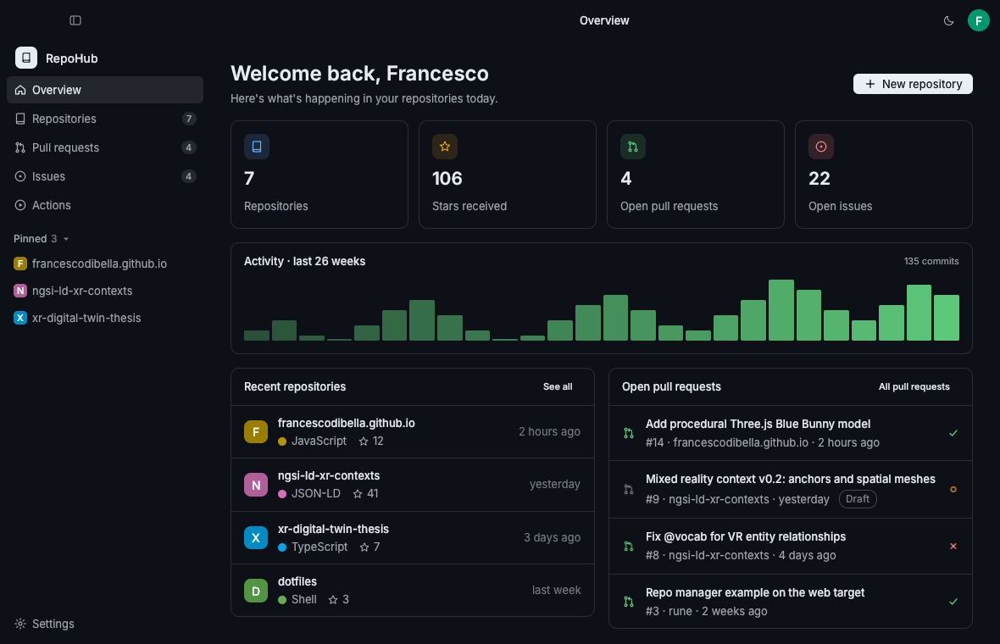
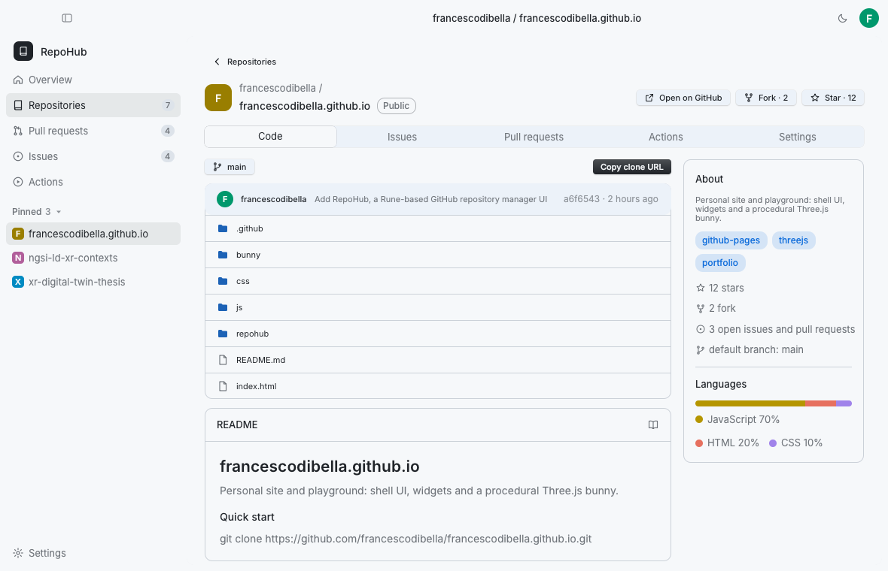
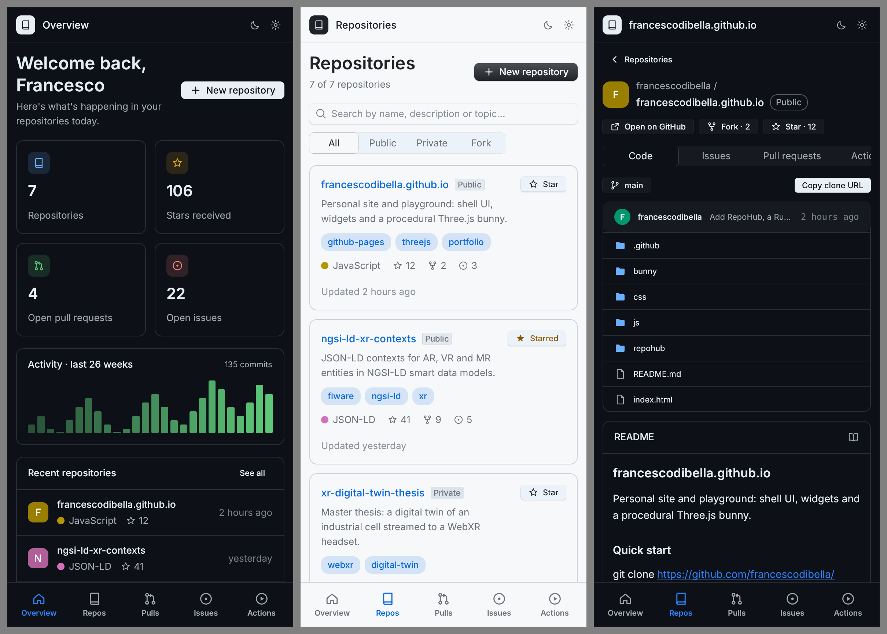
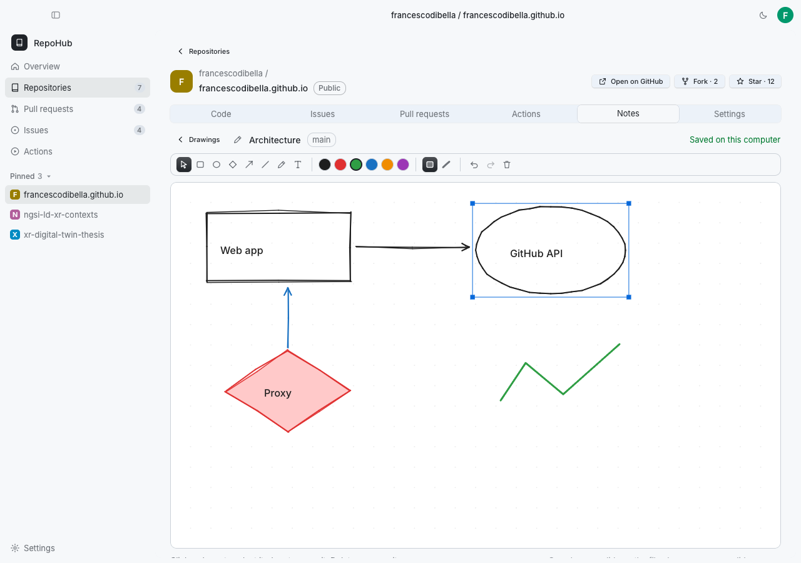
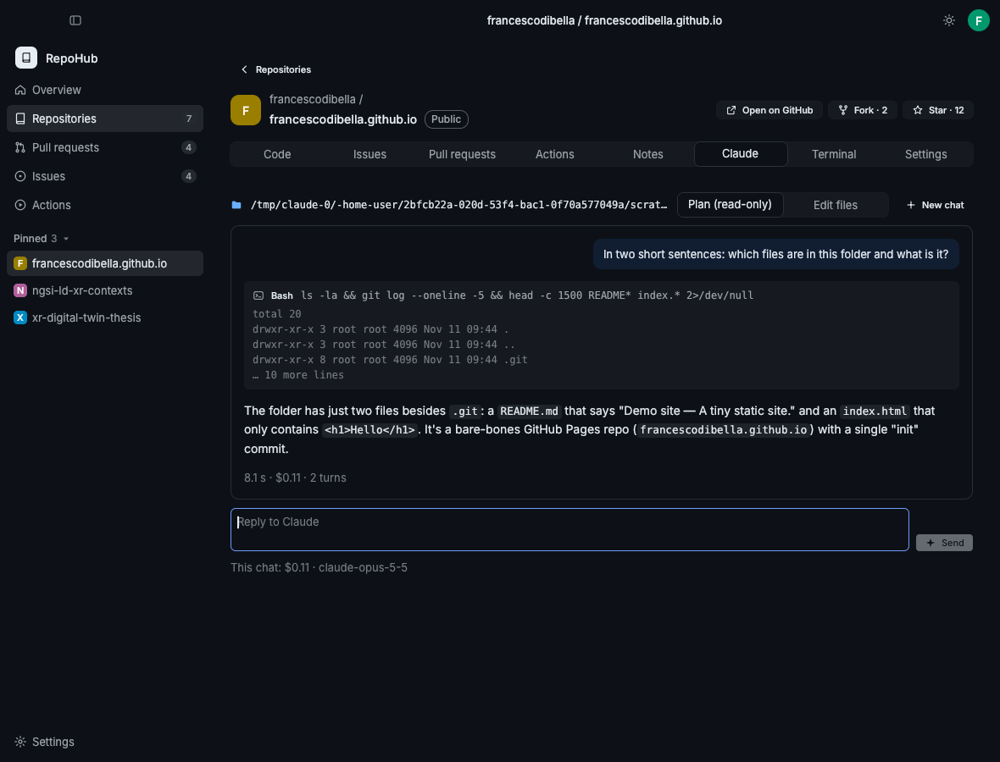
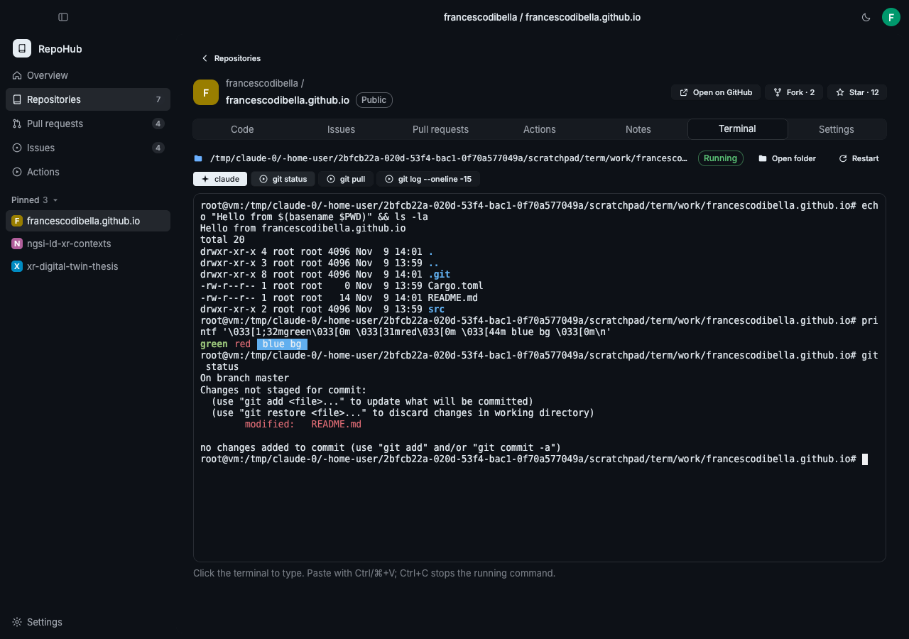

# RepoHub

A dashboard for your own GitHub repositories, written in Rust with
[Rune](https://github.com/anomalyco/rune) (a GPU-rendered UI framework) and `rune-kit`.

It reads real data from the GitHub REST API: profile, repositories, files, README, languages,
last commit, pull requests, issues, workflow runs and weekly commits. You can star and unstar
repositories from the app, and keep **notes**: hand-drawn diagrams and sketches for each
repository and branch, saved on your computer.

| | |
| --- | --- |
|  |  |

There are three ways to run it:

| | What you need | Data |
| --- | --- | --- |
| **Docker** (recommended) | Docker and a browser with WebGPU | yours, from `.env` |
| **Desktop app** | Rust | yours, from `.env` |
| **Static page** (GitHub Pages) | a browser with WebGPU | sample data only |

## Run it with Docker

All you need is [Docker](https://docs.docker.com/get-docker/) (Docker Desktop on Windows and
macOS).

```sh
git clone https://github.com/FrancescoDiBella/repohub
cd repohub
cp .env.example .env        # on Windows: copy .env.example .env — then set GITHUB_USER and/or GITHUB_TOKEN
docker compose up --build   # the first build compiles everything: 10–20 minutes
```

Then open **http://localhost:8080** in Chrome or Edge, which support WebGPU. Some useful commands:
- `Ctrl+C` stops it.
- `docker compose up -d` runs it in the background.
- `docker compose down` removes it.
- After editing `.env`, `docker compose up -d --force-recreate` applies the change without rebuilding.

### How the token stays safe

The image contains two things:
- the web build of RepoHub, compiled to WebAssembly;
- `repohub-server`, a small server that serves the page and forwards API calls to GitHub,
  adding the token on the way.

What this means for the token:
- The token never leaves the container. The page never receives it: `config.json` only says
  whether a token is set.
- The port is published on this computer only (`127.0.0.1:8080`).
- The server forwards only the endpoints RepoHub uses: reads, and writes for starring only.
- The server refuses requests from other origins or with an unknown `Host` header, which blocks
  DNS rebinding.

To reach RepoHub from another device on your network, change `ports` in `compose.yaml` and add
the host name to `REPOHUB_ALLOWED_HOSTS`. Do this only on a network you trust: anyone who can
reach the port uses your token.

### On your phone

Below 720 points of width RepoHub switches to a phone layout: a top bar, the page in one column
and a tab bar at the bottom (Overview, Repos, Pulls, Issues, Actions) instead of the sidebar. The
same happens in a narrow desktop window. Notes work with touch; the terminal stays desktop-only.



The phone opens the same web app the Docker container serves. Two things to know:

- **Browsers only offer WebGPU on HTTPS pages** (or `localhost`), so `http://192.168.x.x:8080`
  doesn't work from the phone. Put the container behind HTTPS, on a private network. The simplest
  way is [Tailscale Serve](https://tailscale.com/kb/1312/serve): with Tailscale on the computer and
  the phone, `tailscale serve 8080` gives a `https://<computer>.<tailnet>.ts.net` address only
  your devices can open. Add that host name to `REPOHUB_ALLOWED_HOSTS` in `.env`.
- **Browser support:** Chrome on Android 12 or later, and Safari on iOS 26 or later.

Then use the browser's **Add to Home Screen**: RepoHub opens full screen with its own icon.
The server holds your token, so never publish the port on the open internet.

### Prebuilt image

The `image` workflow publishes `ghcr.io/francescodibella/repohub` on every push to `main`, for
Intel/AMD (`linux/amd64`) and ARM (`linux/arm64`, Apple silicon included). Once it's published,
there is nothing to build:

```sh
docker run --rm --env-file .env -p 127.0.0.1:8080:8080 -v repohub-notes:/data ghcr.io/francescodibella/repohub
```

A new GHCR package starts out private. Either make it public (your GitHub profile → Packages →
repohub → Package settings) or run `docker login ghcr.io` first.

## Desktop app

A native app for macOS, Windows and Linux: its own window, no browser and no Docker. It is the
only version with the [terminal](#terminal-desktop-app).

### Install

Download the build for your system from the
[Releases](https://github.com/FrancescoDiBella/repohub/releases) page:

- **macOS** (Apple silicon and Intel): open `RepoHub-<version>-macos.dmg` and drag RepoHub to
  Applications. The app isn't notarized by Apple, so the first time right-click it and choose
  **Open**, or run `xattr -dr com.apple.quarantine /Applications/RepoHub.app`.
- **Windows**: unzip `RepoHub-<version>-windows.zip` and run `RepoHub.exe`. SmartScreen may ask
  for confirmation (*More info* → *Run anyway*).
- **Linux** (x86-64): unpack `RepoHub-<version>-linux-x86_64.tar.gz` and run `./install.sh`, which
  puts the program in `~/.local/bin` and adds a launcher entry.

Every push to `main` rebuilds the three packages and replaces the
[**Latest build**](https://github.com/FrancescoDiBella/repohub/releases/tag/latest) pre-release,
so the newest app is always there without doing anything. Pushing a tag such as `v0.1.0`
publishes a numbered release next to it.

### Updates

From the first build that includes it, the app updates itself from the
[Latest build](https://github.com/FrancescoDiBella/repohub/releases/tag/latest):

- It checks GitHub at start and every 6 hours (**Settings → App version → Check now**, or ⌘K →
  *Check for updates*, any time).
- When a newer build is out, a banner (and the status-bar menu) offers **Install and restart**.
  The package for your system is downloaded, checked against the release's `SHA256SUMS`, put in
  place of the running app, and the new version starts.
- macOS replaces `RepoHub.app` where it is (it needs to be in a folder you can write to, such as
  Applications); Windows replaces `RepoHub.exe`; Linux replaces the `repohub` program.
- `REPOHUB_UPDATES=off` turns the checks off. Builds from source update with `git pull`, the
  Docker version with `docker compose pull`.

### Release notes

What changed in each version is in [`CHANGELOG.md`](CHANGELOG.md). The section of a tagged
version (`v0.2.0`) becomes that release's notes. The Unreleased section becomes the notes of the
Latest build, and the update banner shows them under **What's new** before you install.

### Connect your account

Open **Settings → GitHub account**, type your user name and (optionally) a token, and press
**Connect**. No `.env` file is needed.

- With only a user name RepoHub shows your public repositories.
- A token adds private repositories and starring. The **Create a token** button opens the right
  GitHub page.
- The account is saved in the app's settings file, which only you can read:
  `~/Library/Application Support/RepoHub/.env` (macOS), `%APPDATA%\RepoHub\.env` (Windows) or
  `~/.local/share/repohub/.env` (Linux). Any setting from [`.env.example`](.env.example) works
  in that file too.
- A `GITHUB_USER` or `GITHUB_TOKEN` from the environment or a project `.env` wins over the saved
  account; Settings says so when that happens.

### Build from source

You need [Rust](https://rustup.rs). The toolchain version is pinned in `rust-toolchain.toml` and
installed automatically.
- Linux: you also need `libxkbcommon-dev` and `libwayland-dev`.
- Windows: you also need the Visual Studio C++ Build Tools.

```sh
cargo run --release                   # the first build takes a few minutes
packaging/macos/bundle.sh 0.1.0       # macOS: builds dist/RepoHub.app and the .dmg
```

## Themes

**Settings → Appearance** has ready-made themes: Classic Light and Dark, Midnight, Neon, Forest,
Ember, Paper, Ocean and Mono. Pick one for the light appearance and one for the dark one. The
Mode (System, Light or Dark) and the toolbar's sun and moon switch between them. ⌘K → *Theme: …*
works too.

To make your own, choose **Duplicate to customize**. Then you can change:
- **Colours** for each part of the window: page, sidebar and toolbar, panels and cards, text,
  secondary text, accent, borders, background pattern, and the success, warning and danger
  states (`#rrggbb`).
- **Background:** plain, a pattern (dots, grid, lines, diagonal, waves) with its strength and
  size, or a picture (a file on your computer or an `https://` address).
- **Effects:** a glow on buttons, the roundness of corners, and main buttons in the accent colour.

Changes show at once and are saved with your preferences.

## Pinned repositories

The sidebar's **Pinned** section (also in the status-bar menu) starts with `REPOHUB_PINNED` or,
without it, the three most recently pushed repositories. Pin or unpin any repository with the pin
on its card, **Pin** on its page or ⌘K → *Pin …*. The first change starts from what the sidebar
shows, and your pins are remembered from then on (they win over `REPOHUB_PINNED`).

## Where you left off

RepoHub reopens where you were: the page, the repository and its section (Code, Claude,
Terminal…), the sidebar's width and whether it was open, and the Repositories page's sort and
owner filter. It waits for the repositories to load before opening a repository; if that
repository is gone it shows the Repositories page, and if you move first, your move wins. A page
on the command line (`-- page …`, used by scripts) wins too.

## Organizations

The repositories of the organizations you belong to show next to yours, ordered by last push.
Everything works on them as on your own: Code, branches, issues, pull requests, Notes, Claude,
Terminal.

- The Repositories page filters by owner (**All**, **Mine**, each organization); the sidebar's
  **Organizations** section and the command palette (`Repositories in …`) open the same filter.
- Their open issues join the Issues page; pull requests already include everything you're
  involved in.
- `REPOHUB_ORGS` chooses which: empty for all, `none` for only yours, or a list (`acme,xr-lab`).

What you see depends on the token:

| Token | Organization repositories shown |
| --- | --- |
| none | public ones, of the organizations whose membership is public |
| classic, `repo` + `read:org` | all you can access, private included |
| fine-grained | only those of its resource owner: create one whose owner is the organization (the organization must allow fine-grained tokens) |

Organizations that use SAML single sign-on also need the token authorized for them (on GitHub:
Settings → Developer settings → the token → Configure SSO).

## Staying up to date

While an account is connected RepoHub refreshes by itself every 10 minutes
(`REPOHUB_REFRESH_MINUTES`; `0` turns it off), also while it waits in the status bar. Without a
token it never refreshes more often than every 30 minutes, so it can't use up GitHub's 60
requests an hour. A refresh that fails is tried again after the next interval.

"Updated 3 minutes ago" shows on the Overview, in the refresh button's tooltip, in the status-bar
menu and in Settings, which also says when the next refresh is due. ⌘R (Ctrl+R) refreshes now.

## Search and commands

**⌘K** (Ctrl+K on Windows and Linux), or the search button in the toolbar, opens a palette over the
window. Type a few letters (they can be the start of any word, or just letters in order: `rhb`
finds `repohub`) and press Enter:

- any page, repository, open pull request or issue;
- for the repository on screen: New issue, New pull request, New branch, Ask Claude, Open a
  terminal, Open on GitHub, Copy the clone URL, and its sections;
- Refresh and the theme.

↑ ↓ move through the results, Esc or a click outside closes it.

## Working on GitHub from the app

With a token that has write access, the everyday changes happen in RepoHub:

| Where | What |
| --- | --- |
| Code tab | **Branch picker** (the branch button): files, last commit and README follow the branch you pick, and so does the Notes tab. **New branch** starts one from the branch on screen. |
| Code or Pull requests tab | **New pull request**: pick its branch and the one it goes into, title, description, draft. |
| Issues tab | **New issue**: title and Markdown description. |
| Issue rows | **Close**. |
| Pull request rows | **Files** shows what it changes as a diff, unified or side by side, with syntax colours and word changes. From there **Merge** with a merge commit, **Squash** or **Rebase**. **Merge** on the row asks first. |
| Changes tab (desktop, with a local clone) | What changed since the last commit, as a diff, new files included. **Commit** or **Commit and push** everything with a message. **Push**, **Pull** (fast-forward only), and **New pull request** from the branch. |
| Changes tab: merging | **Merge a branch** into the one checked out: pick it to preview its commits and the diff it brings, then merge. If there are conflicts, it lists the files and offers **Abort merge**. Fix them in your editor or the Terminal, then **Commit** finishes the merge. Commit refuses files that still have conflict markers. |

What GitHub creates shows at once; the lists catch up on the next refresh. GitHub's error, if
any, shows in the form (for example "A pull request already exists").

RepoHub still doesn't delete repositories or branches or rewrite history: those stay on GitHub.
Commit, push and pull run the `git` installed on your computer, in the clone, with your own
credentials.
In Docker the same actions go through `repohub-server`, which forwards only these writes.

The token needs, as a fine-grained token: **Contents**, **Issues** and **Pull requests** read
and write, **Metadata** and **Actions** read. A classic token needs the `repo` scope.

## Files on your computer (desktop app)

When RepoHub knows a repository's local clone (found as in the Terminal tab, or a folder you
picked), the Code tab reads its files from the disk instead of GitHub. That's instant, works
offline, uses none of GitHub's requests, and includes what you haven't committed yet.

- Folders open in place. A trail of folder names takes you back up.
- Changed files are marked: M modified, A added, D deleted, R renamed, U new (not tracked yet),
  ! in conflict. The title counts them.
- A file opens with syntax colours, and Markdown is rendered. Copy takes the whole file, and
  GitHub opens the committed version. Files longer than 5,000 lines or 1 MB show their beginning,
  and binary files show a note.
- Files git ignores are left out. **Refresh** lists the files again after you change them
  outside RepoHub, and **GitHub** switches to the files on GitHub.

## README

The Code tab shows the repository's README rendered as Markdown. Select text as on a web page
(drag, double- or triple-click; Ctrl/⌘+A for all) and copy it with Ctrl/⌘+C or a right-click.
Copying whole blocks copies their Markdown, so a pasted code block keeps its fences. **Copy** in
the panel's head copies the whole README, and each code block has its own copy button.

## Notes

Each repository has a **Notes** tab with a small whiteboard in the spirit of
[Excalidraw](https://excalidraw.com), built natively with Rune.



- **Branches:** pick a branch, then name a drawing to create it or open an existing one. Each
  branch keeps its own drawings.
- **Shapes:** rectangles, ellipses, diamonds, arrows, lines, freehand strokes and text, with the
  hand-drawn look Excalidraw is known for.
- **Style:** six colours, filled shapes and bold strokes.
- **Editing:** select and drag to move, Delete to remove, Ctrl/⌘+Z to undo and Ctrl/⌘+Shift+Z to
  redo.
- **Saving:** every change is saved at once, in Excalidraw's `.excalidraw` format, so a drawing
  also opens on excalidraw.com (*Open* → pick the file).

Drawings never go to GitHub. They are stored at
`notes/<owner>/<repo>/<branch>/<name>.excalidraw` inside:
- the desktop app: `REPOHUB_DATA_DIR`, or the platform's data folder (`~/.local/share/repohub`,
  `~/Library/Application Support/RepoHub`, `%APPDATA%\RepoHub`);
- Docker: the `notes` volume (`/data` in the container), which survives rebuilds and updates.

The static GitHub Pages build has nowhere to store them, so the tab explains that instead.

## Status bar (desktop app)

RepoHub puts an icon in the macOS menu bar and the Windows notification area (and a Linux tray,
where one runs). Its menu has:

- **Open RepoHub**; how many pull requests and issues are open and how many runs failed, each
  opening its page;
- the pinned repositories, each opening in RepoHub;
- **New issue in …** for the repository on screen (or the first pinned one);
- **Refresh** and **Quit RepoHub**.

On macOS and Windows, closing the window keeps RepoHub in the status bar; quit it from the menu
(or ⌘Q on macOS). `REPOHUB_TRAY=0` turns the icon off, and closing the window then quits.

## Claude (desktop app)

Each repository has a **Claude** tab: a chat with [Claude Code](https://claude.ai/code) running in
the repository's local copy, much like the Claude Code extension for VS Code.



- It runs your own `claude` with your own login, in the clone's folder, so RepoHub needs no
  API key. The local copy is found as in the Terminal tab.
- Claude's answers are rendered as Markdown (selectable, with copy buttons on code); each tool it
  uses (Read, Edit, Bash…) shows as a row with the start of its result.
- **Plan (read-only)** lets Claude read only; **Edit files** lets it change files in the local
  copy. What it wasn't allowed to do is listed after the answer: switch mode, or run it in the
  Terminal tab.
- Replies continue the conversation (`--resume`); **New chat** starts over; **Stop** ends the
  answer. Each answer shows its time and cost, and the chat its total.
- RepoHub looks for `claude` in the usual install places, then on your login shell's PATH. If it
  lives elsewhere, set `REPOHUB_CLAUDE` to its path.

## Plugins (desktop app)

Plugins add a section to repository pages, a page of their own in the sidebar, or both. Anyone
can write one. A plugin is a folder with a `plugin.json` and a small [Luau](https://luau.org)
script that draws with Rune's UI. It runs sandboxed: no files, programs or network, only what
RepoHub shows it and a few actions (open a link, copy, notify, open a repository).

- **Settings → Plugins → Create a plugin** writes the example, *Checklist*: a release checklist
  on each repository and a page with everyone's progress. Edit its files and it reloads as you
  save.
- **Install** takes a folder or a Git address (it's cloned). Each plugin can be turned off,
  reloaded or removed. Errors show in place of the plugin, never crashing the app.
- ⌘K lists plugin sections and pages too.

The guide is [`docs/PLUGINS.md`](docs/PLUGINS.md), and the example is
[`plugins/checklist`](plugins/checklist).

## Coding assistants

**Settings → Coding assistants** chooses which assistants RepoHub offers:

- **Claude** turns the Claude section on or off: the Claude tab of each repository, and every
  harness or terminal button that runs `claude`. It's on by default.
- **Harnesses** are any program that works in a repository's folder: Claude Code, Codex, Aider,
  opencode, Gemini CLI, Goose, or your own. Give it a name and the command that starts it (for
  example `codex --full-auto`), or add a well-known one with a click. Each gets a button in the
  Terminal tab and a ⌘K command that starts it in the local clone.

## Terminal (desktop app)

Each repository has a **Terminal** tab: your login shell in a real pseudo-terminal, opened in the
repository's **local clone**, so `claude`, `git`, `npm`, `cargo` and the rest run with the right
working directory and your usual environment. Full-screen programs (Claude Code, vim, htop) work,
with colours, scrollback (mouse wheel) and paste.



- **Finding the clone:** RepoHub looks for a checkout named after the repository in
  `REPOHUB_REPOS_DIR` (comma-separated folders) or in `~/Developer`, `~/Projects`, `~/code`,
  `~/src`, `~/GitHub`, `~/repos` and `~/Documents/GitHub`. You can also type the folder, or press
  **Clone into …** to clone it there. A folder you pick is remembered.
- **Coding assistants:** each harness in **Settings → Coding assistants** gets a button, such as
  **Claude Code** or **Codex**, that starts it in the clone. ⌘K → *Start … in …* does the same.
- **Command buttons:** one click types `git status`, `git pull` or `git log`. Set your own list
  with `REPOHUB_TERMINAL_COMMANDS` (`;`-separated).
- **Security:** `GITHUB_TOKEN` and `GITHUB_USER` are stripped from the terminal environment by
  default to protect against untrusted scripts and tools. You can opt in with `REPOHUB_TERMINAL_PASS_TOKEN=true`.
- **Keys:** click the terminal to type. Ctrl+C, arrows, Tab, Ctrl+R… go to the shell;
  Ctrl/⌘+V pastes.

The terminal is in the desktop app only. A web page can't start programs on your computer. In
Docker a shell would run inside the container, without your tools, credentials or files, and
anyone who could reach the port would get it.

## Configuration

Settings live in `.env`. It is ignored by git (`.gitignore`) and by Docker builds
(`.dockerignore`), so it is never committed or baked into an image.

```sh
# Public data only (60 API requests an hour, no private repositories)
GITHUB_USER=your-username

# Everything, private repositories included (5,000 requests an hour)
GITHUB_TOKEN=github_pat_...
```

[`.env.example`](.env.example) documents every option and the token permissions to grant. The
options cover the title, theme, pinned repositories, forks and archived repositories, the
maximum number of repositories, how many repositories to read activity from, demo mode and
GitHub Enterprise.

- Variables already set in the environment win over the file. Watch out if your shell already
  exports a `GITHUB_TOKEN` (desktop app).
- Desktop app: `REPOHUB_ENV=/path/to/other.env` loads an explicit settings file. For security,
  installed release builds do not automatically load `.env` files from arbitrary working directories;
  in development builds, upward directory search loads project `.env` files while restricting
  sensitive overrides (`GITHUB_API_URL`, `REPOHUB_UPDATE_API`, `REPOHUB_CLAUDE`, `REPOHUB_DATA_DIR`).
  Tokens saved in the app settings are never sent to custom API hosts unless configured directly
  in the process environment or app settings.
- Docker: `REPOHUB_ALLOWED_HOSTS` adds host names besides `localhost`.

## What it shows

| Page | Data and actions | API |
| --- | --- | --- |
| Overview | totals, commits over the last 26 weeks, recent repositories, open pull requests | `/user` or `/users/{u}`, `/user/repos` or `/users/{u}/repos`, `/search/issues`, `/repos/{r}/stats/participation` |
| Repositories | search by name, description and topic; public, private and fork filters; star | `/user/starred`, `PUT`/`DELETE /user/starred/{r}` |
| Repository | root files, README, languages, last commit, copy clone URL, open on GitHub | `/repos/{r}/contents`, `/readme`, `/languages`, `/commits` |
| Pull requests | pull requests you're involved in: open, draft, merged, closed; click to open | `/search/issues?q=is:pr involves:{u}` |
| Issues | open issues in your repositories; click to open | `/search/issues?q=is:issue is:open user:{u}` |
| Actions | latest runs of the most recently pushed repositories | `/repos/{r}/actions/runs` |
| Repository → Notes | drawings per branch: create, open, draw, delete | `/repos/{r}/branches` (the drawings stay on your computer) |
| Settings | connection status, the configuration in use (the token is never shown) and where notes are kept | — |

How it behaves:
- **Refresh** (toolbar icon, or ⌘R / Ctrl+R) reloads everything.
- Requests run in the background, so the window stays responsive.
- Errors (rejected token, rate limit, unknown user) show a banner with the reason and **Retry**.
- RepoHub never creates, changes or deletes repositories. "New repository" and "Settings on
  GitHub" open GitHub in the browser.

## Development

See [CONTRIBUTING.md](CONTRIBUTING.md) for the project layout, how to test and how the pieces fit
together.

## Status

Rune is pre-release, so RepoHub pins a revision of its `dev` branch in `Cargo.toml`.
