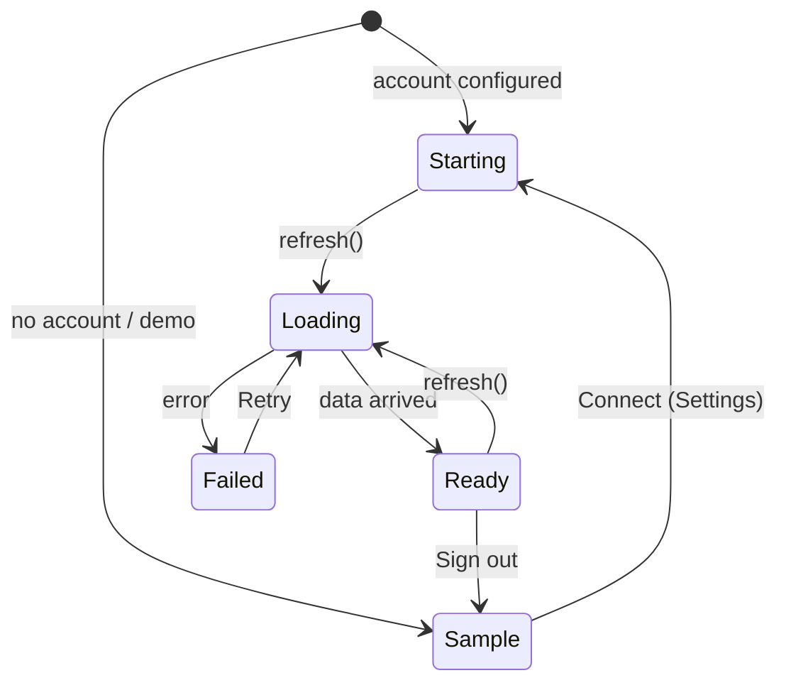
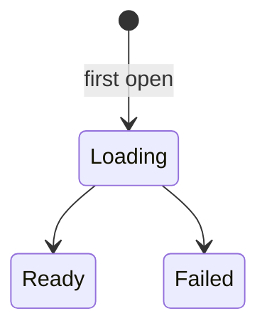
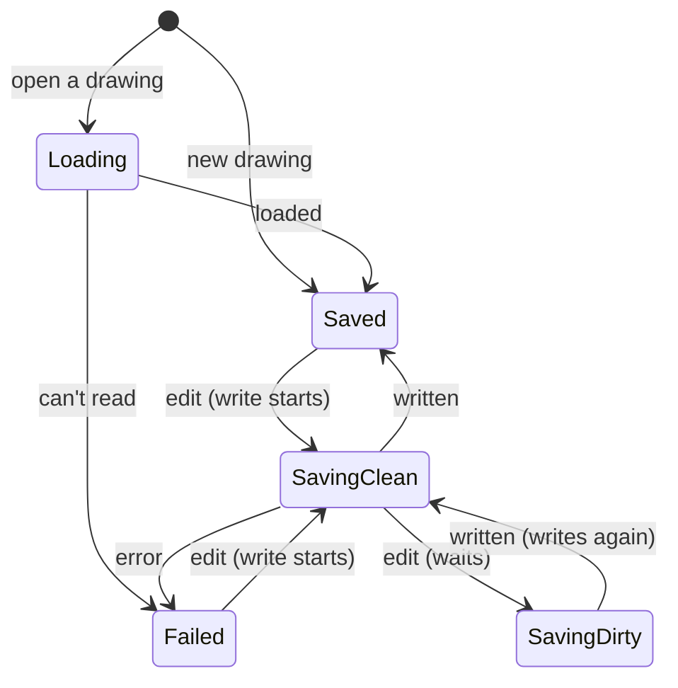
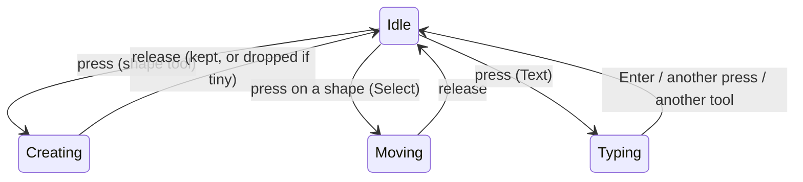
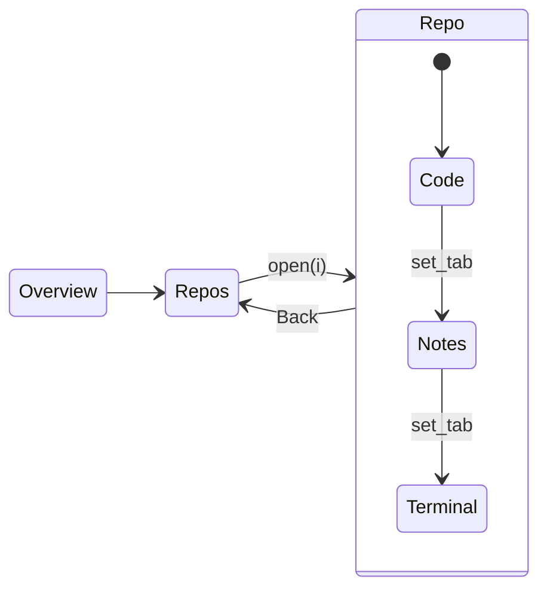
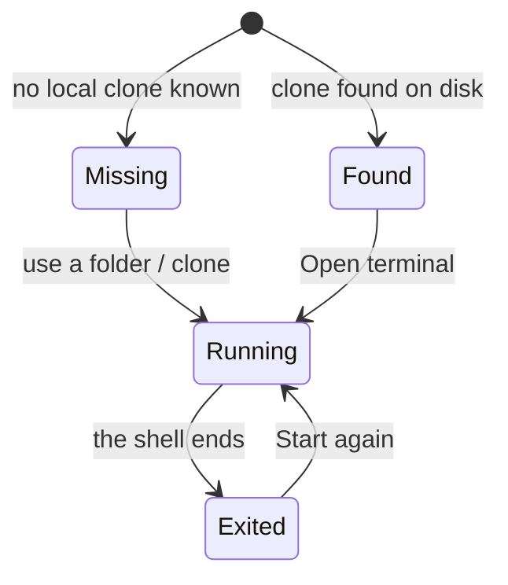

# State machines

RepoHub's states are named types in [`src/state.rs`](../src/state.rs) (and two local ones next
to their code). A state that makes no sense can't be written, and every change goes through one
method. Run with `REPOHUB_TRACE=1` to see each change on stderr:

```
state: status "starting" -> "loading"
state: page Overview -> Repo(0)
state: tab Code -> Notes
```

## Data source: `Status`



`refresh()` only starts from `Starting`, `Ready` or `Failed` (`Status::can_load`), so two loads
never run together.

## Something fetched once: `Load<T>`

Repository details and branch lists. A missing map entry means "not asked yet".



The drawings list uses `Refresh` instead (`Loading`, `Fresh`, `Failed`): it keeps its last items
on screen while it reloads.

## Saving a drawing: `Save`



One write runs at a time. Edits made meanwhile set `dirty` and are written next, so an older
write can't land after a newer one. Closing the editor writes whatever is still pending.

## The canvas: `board::Mode`



## Navigation: `Page` and `RepoTab`



`go(page)` and `set_tab(i, tab)` are the only ways to move. Leaving a section closes the open
drawing (after writing it) and drops pending confirmations and error messages; entering Notes
loads its lists, entering Terminal opens the shell when the clone is known.

## The Terminal tab: `terminal_page::Panel`



## Smaller ones

| Type | States | Notes |
| --- | --- | --- |
| `Theme` | `System`, `Light`, `Dark` | `toggled()` flips what is on screen; saved by name |
| `RepoFilter` | `All`, `Public`, `Private`, `Fork` | `matches(private, fork)` |
| `RepoSort` | `Recent`, `Stars`, `Name` | |
| `PullState` | `Open`, `Draft`, `Merged`, `Closed` | also the Pull requests page's filter |
| `Account` | `Locked`, `SignedOut`, `SignedIn` | `App::account()`; drives the form in Settings |
| `Toast` | none → shown (`Done` / `Problem`) → none | its timer hides only its own message |
| `markdown::Block` | `Text`, `Fence`, `Comment` | the README pass, line by line |

## For agents and scripts

- `-- page repo tab notes` opens a section by name (numbers still work).
- `REPOHUB_TRACE=1` prints every transition.
- Every control has a stable key (`tabs`, `theme`, `acct-save`, `tool-Rectangle`…) for `--script`.
