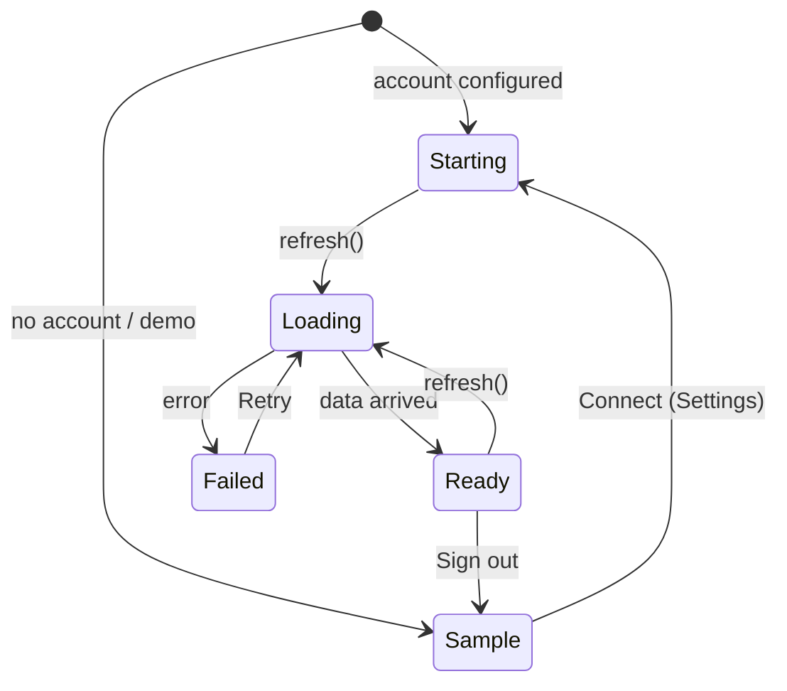
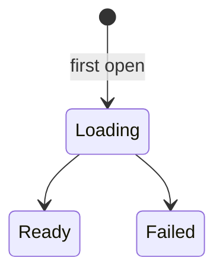
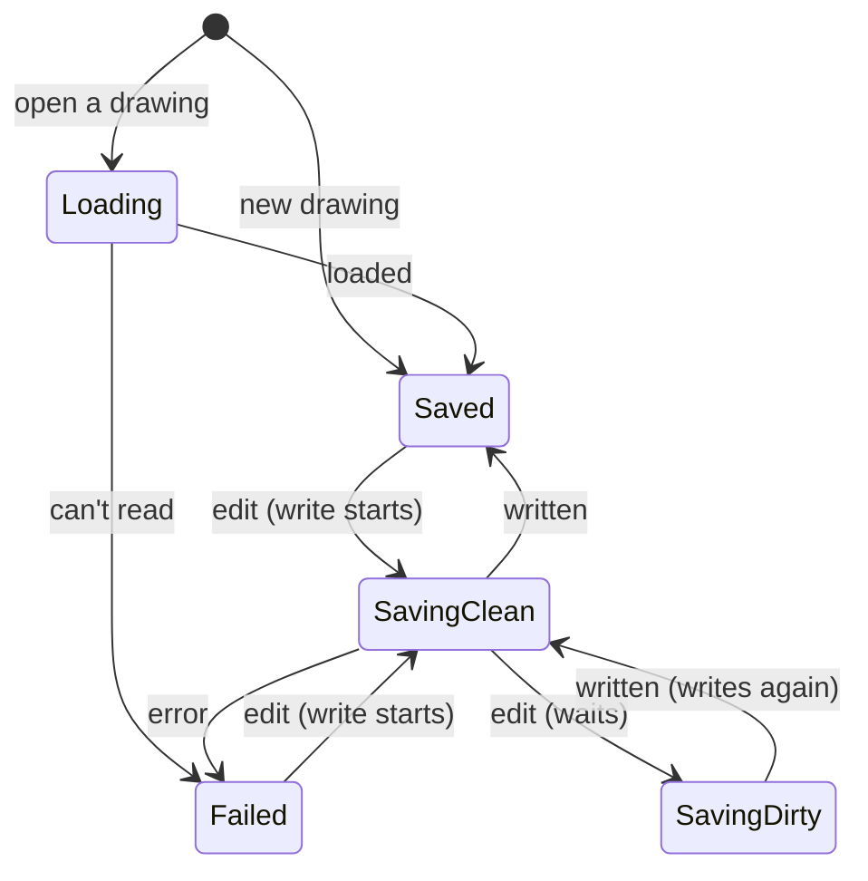
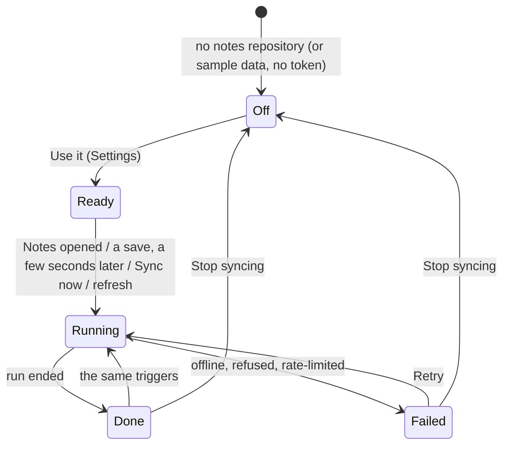
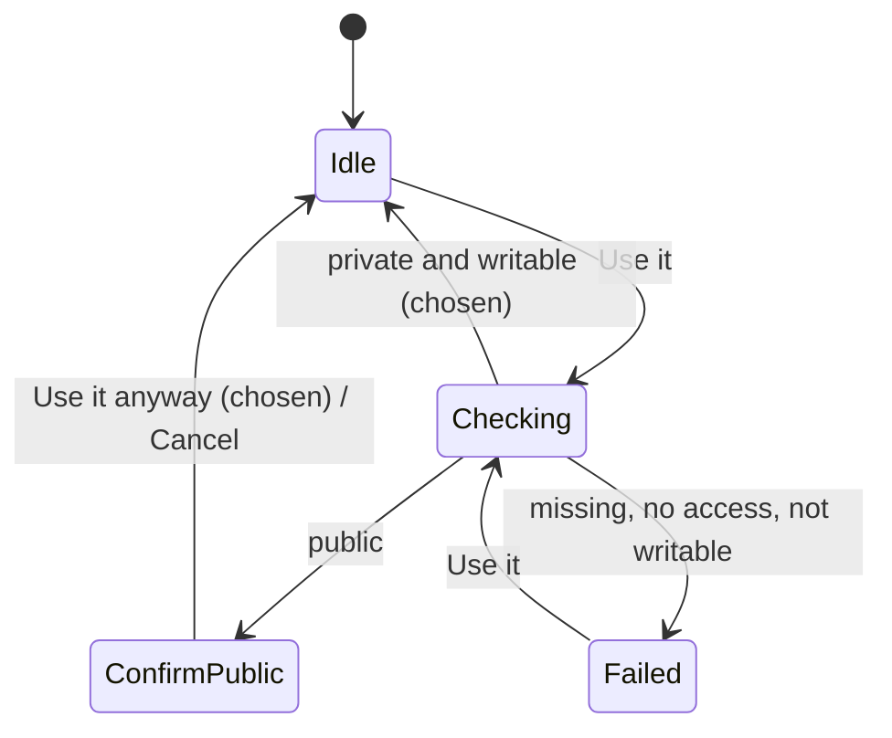
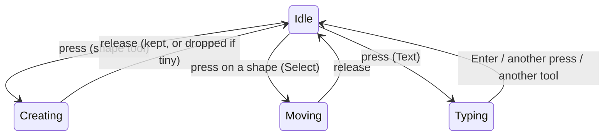
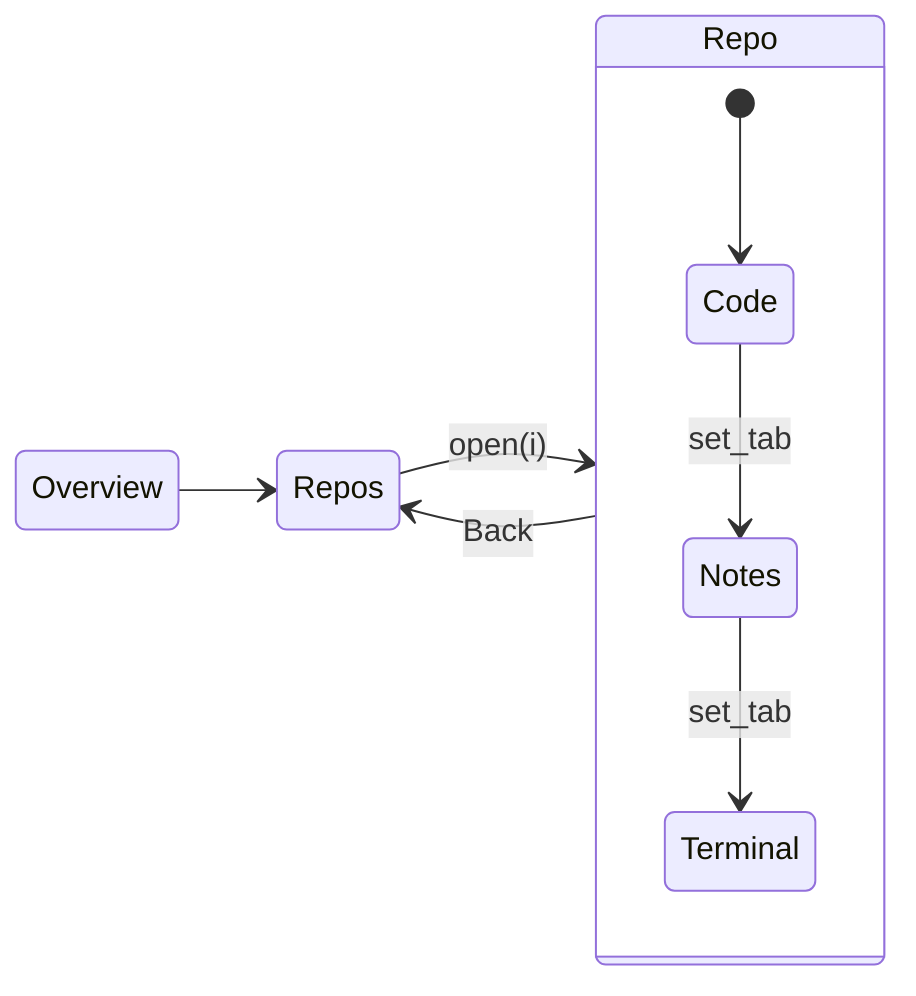
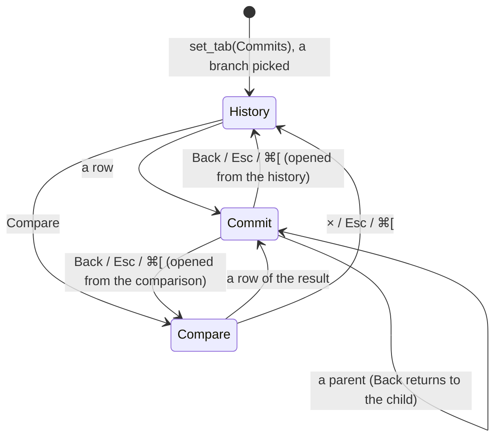
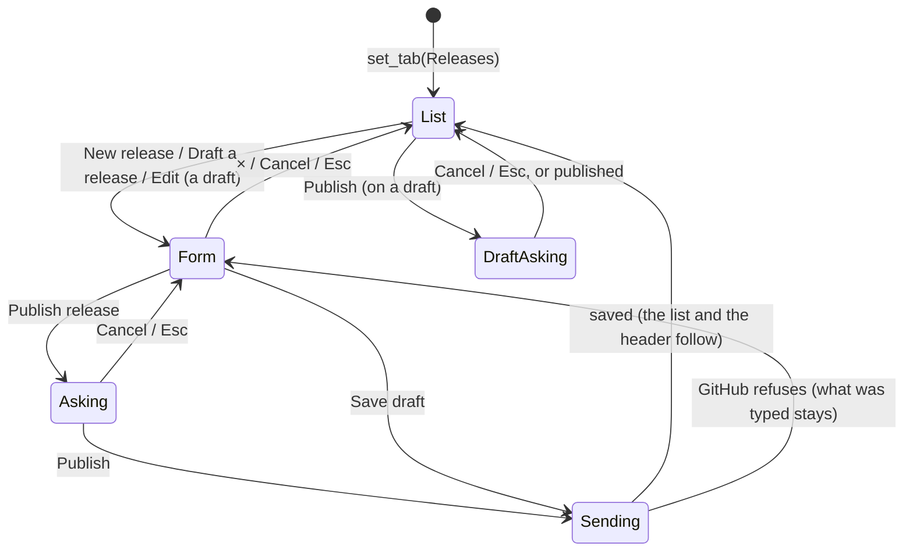
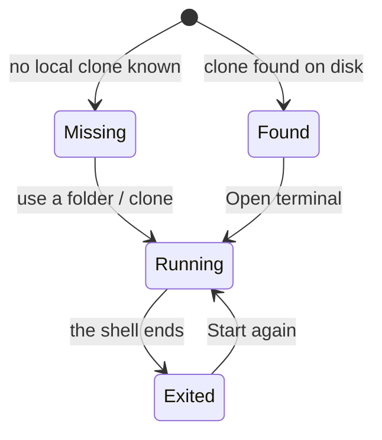

# State machines

RepoHub's states are named types in [`src/state.rs`](../src/state.rs) (and two local ones next
to their code). A state that makes no sense can't be written, and every change goes through one
method. Run with `REPOHUB_TRACE=1` to see each change on stderr:

```
state: shown "nothing" -> "saved copy"
state: time "saved copy shown" -> "4 ms"
state: status "starting" -> "loading"
state: time "first frame" -> "90 ms"
state: page Overview -> Repo(0)
state: tab Code -> Notes
```

`time` lines say how long since the process started: the saved copy shown, the first frame, the
profile and repositories shown, the load done, the copy written.

## Data source: `Status`



`refresh()` only starts from `Starting`, `Ready` or `Failed` (`Status::can_load`), so two loads
never run together.

What is on screen meanwhile (`cache::Fresh`, beside `Status`):

| | Nothing saved (first start) | Saved copy (`from_copy`) | Loaded in this session |
| --- | --- | --- | --- |
| `Starting`, `Loading` | skeletons, then the profile and repositories with the other lists loading (`partial`) | the copy, "Updating…" | the lists, "Updating…" |
| `Ready` | — | — (the copy is replaced) | "Updated 3 minutes ago" |
| `Failed` | the error with **Retry** | the copy, the error and "The lists show what was saved 2 hours ago" | the lists and the error |

A load's results carry the account generation (`load_gen`): a load or a part of one that started
before a sign-out or an account switch is dropped, and the copy it would have saved is never
written (`cache::forget_all` stops writes still on their way).

## Something fetched once: `Load<T>`

Repository details and branch lists. A missing map entry means "not asked yet".



The drawings list uses `Refresh` instead (`Loading`, `Fresh`, `Failed`): it keeps its last items
on screen while it reloads.

## Saving a drawing: `Save`



One write runs at a time. Edits made meanwhile set `dirty` and are written next, so an older
write can't land after a newer one. Closing the editor writes whatever is still pending.

A write merges with the file if it changed underneath (sync brought another device's edits):
`notes::save` reads, merges (`sync::merge`) and writes in one step, and the editor takes in the
merge (`Board::merge_json`).

## Boards on every device: `BoardSync` and `NotesRepoCheck`



A trigger while a run is `Running` sets `again`, and one more run follows. A run's result is
dropped if a newer run started or the account changed (`sync.run`, `load_gen`). The boards
still to send (`sync.to_send`) are counted live, so a save after the run shows at once.

Choosing the repository in Settings:



What a run does with each board is a pure function, `sync::decide`, of the local side and the
remote side (unchanged, changed, deleted, new) against the index; `sync::tests` checks all 16
cells.

## The canvas: `board::Mode`



## Navigation: `Page` and `RepoTab`



`go(page)` and `set_tab(i, tab)` are the only ways to move. Leaving a section closes the open
drawing (after writing it) and drops pending confirmations and error messages; entering Notes
loads its lists, entering Terminal opens the shell when the clone is known.

## The Commits section: `commits::Commits`



The history (`History`), the open commit (`Open`) and the comparison (`Compare`) each hold a
`Load` and the epoch of the request they wait for; an answer with another epoch (another branch,
commit or comparison, or a reload since) is dropped, as is one for another account (`load_gen`).
Leaving the section closes the commit and the comparison; the history stays for next time.

## The Releases section: `releases::Releases`



The list (`List`) holds a `Load` and the epoch of the request it waits for; an answer for another
repository, a reload since, or another account is dropped. Generate notes waits the same way, and
its answer waits for a yes (`Form::offered`) when the notes field has something you typed.
Publishing happens only from the question (`Form::confirm`, `Releases::confirm`); leaving the
section drops the question and keeps the form. Each repository's latest release (`latest`) is
read when its page opens, for the header.

## The Terminal tab: `terminal_page::Panel`



## Smaller ones

| Type | States | Notes |
| --- | --- | --- |
| `Theme` | `System`, `Light`, `Dark` | `toggled()` flips what is on screen; saved by name |
| `RepoFilter` | `All`, `Public`, `Private`, `Fork` | `matches(private, fork)` |
| `RepoSort` | `Recent`, `Stars`, `Name` | |
| `PullState` | `Open`, `Draft`, `Merged`, `Closed` | also the Pull requests page's filter |
| `Account` | `Locked`, `SignedOut`, `SignedIn` | `App::account()`; drives the form in Settings |
| `Toast` | none → shown (`Done` / `Problem`) → none | its timer hides only its own message |
| `Facet` | `Labels`, `Assignees`, `Milestone`, `Reviewers` | the open triage picker (one at a time, or none); Apply sends one `triage::Change` |
| `markdown::Block` | `Text`, `Fence`, `Comment` | the README pass, line by line |
| `releases::TagUse` | `Invalid`, `Taken`, `Existing`, `New` | what the form's tag does: refused, another release's, used as it is, or created from the target branch |
| `releases::NotesJob` | `Idle`, `Asking`, `Failed` | Generate notes |

## For agents and scripts

- `-- page repo tab notes` opens a section by name (numbers still work).
- `REPOHUB_TRACE=1` prints every transition.
- Every control has a stable key (`tabs`, `theme`, `acct-save`, `tool-Rectangle`…) for `--script`.
